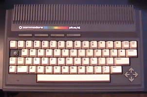
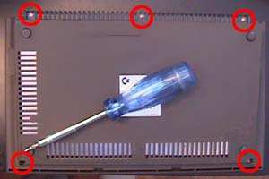
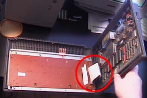
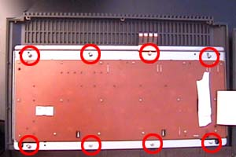
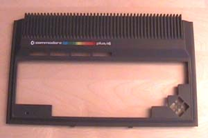
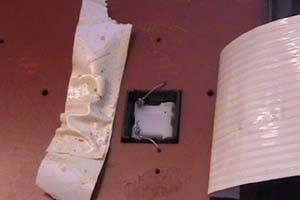
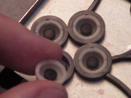
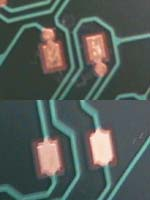

# How Can I Clean My Keyboard?

- Source: https://plus4world.powweb.com/plus4encyclopedia/500009
- Category: Hardware
- Keywords: cleaning, keyboard Credits TLC, Csabo

This topic will give you details on how to clean your Plus/4 keyboard which after years of use (or years of colleting dust), the keys start to respond less and less to keystrokes. So let's clean it!

All Plus/4 Keyboards can be saved as the keys are nothing more than gaming joypad style of buttons where the key's use rubber like contacts and the main board it's self is plated with gold!
The reason Plus/4 keyboards start to fail is because from minimal heat Gold attracts dirt, dust and grime in the air we breath. Over time this lays a small film of grease and dirt over the gold contacts which you can't see with your own eyes blocking the contact. Keys may start to respond less and less leading you to press harder and harder to the point a key may not work. This is not just a problem with Commodore Plus/4's as it can even happen on C64's, C16's and all types of computer keyboards although it may take longer for nature to work it's magic. This can also happen with joypads from Sega MegaDrive, Sega Saturn, SNES and any other digital contact controls that are aging. Gold is found in a lot of computer equipment and even game cartridges from across the ages are not immune from attracting dirt from the air when lightly heated up by the machines when being used and may look as if they are dead...

A cleaning solution we can use to clean the contacts are normal everyday Glass Cleaner Spray's such as Windowlene which is great for dissolving grease, cleans with vinegar and evaporates very quickly. All you need is a small drop on a rag and wipe over the contact to clean.

Before we start you will need a couple of different size Phillips screwdriver, small flat screw driver, long nose pliers, a soldering iron and are capable of desoldering 2 wires and to then solder them back on, some cleaning solution such as windowlene and a clean rag or an old cotton T-shirt will be fine.

A second pair of hands can come in handy with the soldering using the long nose pliers to pull the wires away as you desolder them.

Step 1) Prepare

First of all the Plus/4, turn the power off and unplug all cables such as power, 1531 tape deck, serial cable, joysticks, video lead and remove any cartridge you might be using. Don't forget to remove the RF cable on the left side if you're using one. You will also need enough room on a desk that can hold the Plus/4 with it's cover off which will be just over the table size as if 2 plus/4's are sat side by side.

Step 2) Taking the Plus/4 apart.

Flip your Plus/4 upside-down. The back cover is held by 5 large screws (marked on our picture with red circles). Find and unscrew them making sure we know which screws came out of which hole for when we put them back in, (See Step 4 for more info on self tapping screws) then put them aside in a safe place. With the screws out hold both the bottom and top half of your Plus/4 and turn it over again so the keyboard is facing you. Gently lift the top half, (Keyboard) from the air vents away from you to pull the keyboard away from the base where it joins just below the space bar on the bottom half of the machine, but only a couple of millimeter so it's free. The keyboard is connected via a large flat ribbon cable on the left side of the mother board looking top down inside which will become a hinge. With the keyboard slightly free now lift the whole keyboard from the right side using the left side as a hinge so the keyboard ends up face down right next to your plus/4.
Please see (Step 3) image below as a guide to where the keyboard ribbon cable joins the mother board so you know what to expect as you lift the keyboard up and over to the left of the bottom half.

Step 3) Showing the Keyboard Ribbon Cable & Removal.
The keyboard ribbon cable is much like a thin version of a cartridge connection, however some caution is required so not to bend it in any way when removing and placing it back in. Holding the cable from both sides where it joins the mother board give it a gentle pull to remove it. Now place the bottom half of your Plus/4 out of harms way in a safe place.

Step 4) ALL 26 Screws need Removing.
Before we take any more screws out lets remind or self's not to mix the large ones up with the outer case holding screws so put these to one side away from the others, but before you do read on... As shown in RED again these 8 screws hold the keyboard to the outer shell of the case and as you remove them place each one down so it returns back in to its original hole when we do it back up. These are self tapping screws and are only meant to be used once, however the plastic has made a nice snug fit around its original screw and will go back in perfectly if you use the original screw you took out. Now remove the whole keyboard from its outer case.

Also on the back of the keyboard are 18 small gold colour screws and each of these need taking out. Be sure and careful of the one hiding under the keyboard ribbon cable and remove that too.

Step 5) The Commodore Minus/4 & Minus Keyboard.
While the outer keyboard case is off lets give it a dust off both out and in, after all this is what gives the Plus/4 it's sexy looks.
Now would be a good time to plug your Soldering Iron on to get it warmed up as your cleaning the outer case.
Here is a thought... Have you ever looked at the back end, (top side) of a Commodore Amiga A500 & A500+? They have the same air vent styling as our good old plus/4, C116 and the very rare 264!

Step 6) Desoldering of the SHIFT/LOCK Key.
If you're not sure how to use a soldering iron then please ask some one who does and stick around as your come in handy holding the long nose pliers!

What we are looking at here is the SHIFT/LOCK key. Before you get to see this part your need to remove the insulating sticky tape or foam like covering that has been placed over the top.
The two thin wires are actually joined to the contact side of the keyboard it's self so they are all one part - these wires belong to the contact board, however we need to desolder the wires from the SHIFT/LOCK key ONLY. Where the wires join and have been soldered to the SHIFT/LOCK we need to heat the solder up and this is where a second person can come in handy. The second person can hold on to the wires using the long nose pliers and as the solder starts to melt gently pull the wire away. Of course the person doing the desolder is the one in charge and should give warning when the solder is starting to melt. Please note that these wires are very fragile so no force should be used when pulling the wires. Only a gentle pull as soon as the solder starts to melt is all that is needed and once clear repeat for the other one. Don't worry about the left over solder we have left behind as this will come in handy when we join it back together and of course add a drop of fresh solder for good measure.

Also note that Soldering Irons are very HOT and the SHIFT/LOCK key is made of plastic. Any prolonged heat may damage the switch so it is advised your soldering iron be properly warmed up as solder only takes a matter of moments to melt at the right temperature. No half measures, it's your plus/4 on the line so respect it and it will respect you!

Once you have finish removing both SHIFT/LOCK wires turn your Soldering Iron off and place it out of harms way!

Step 7) Plus/4 Power Light & Keyboard Contact Board Removal.
**PLEASE NOTE**: We have jumped the gun just a little in this shot because before we lift off the contact board we need to un-clip the final component being the Plus/4 Power Light. The Power Light, (circled in red where it clips in) is held in by a one way clip and at the side we are looking down at and with closer inspection you should see how it's held in. Again just a gentle push back of the clip with a small flat screw driver is needed as you lift up the whole keyboard contact board. **Caution** is advised as aging plastic becomes brittle and any force may break or damage the clip. Nice and slow, softly and with patience you will release the power light in no time.

If you have got this far then one more thing to take note of. If you lift or turn the keyboard at this point before removing the keyboard contact board the Arrow Key's & Function Key's rubber contacts may fall out. Watch out for that so you don't lose any and of course use our pictures for reference to where they go back in.

Caution is advised when placing the keyboard contact board down as seen in the above picture as our Plus/4 Power Light sticks out and we don't want to bend it! Handle with care always and when we come to cleaning it, more on that later in (Step 10).

**CONGRATULATIONS**, you have successfully opened up your Plus/4 keyboard ready for cleaning!

Step 8) Cleaning the Key Contacts.
With closer inspection we can see each key contains a rubber like contact and it's this very contact we need to clean with our grease removing solution such as glass cleaner spray. As already said the glass cleaner spray Windowlene is great for dissolving grease, cleans with vinegar and evaporates very quickly. The last thing we want to use is anything that is water based as it will take ages to dry and may cause the key springs to rust if water gets inside. Water & electrics don't mix! All you need is a small drop of your grease removing solution on a rag and wipe over the contact to clean in turn. You can press any KEY from the other side to lift the contacts up for easier cleaning reasons. Make sure each rubber like key contact has been thoroughly cleaned both contact face and sides, a little pressure will not damage or remove the contacts so worry not about them coming off. Just make sure you clean each one properly with care so we don't have to take it all apart again 30mins later once we power up because one key is still not responding properly... Your cleaning solution may dry quickly, but allow a little time for everything thing to dry properly in case any solution has past beyond the contacts before putting it all back together when the time comes.

Again we can also see the Arrow & Function key contacts in this image, more on that in (Step 9) below.

Of course with the keys them self fully exposed we can flip the whole thing over and give the keys a good wipe down and remove any dust that might be around the edges with a small brush or dust rag. Your solution for cleaning the contracts is fine for cleaning the keys, in fact if you have any sticky like substance on any plastics then normal Lighter Fluid and just a small drop on a rag can help remove such marks. Please google for more info on using Lighter Fluid for cleaning purposes, normally linked with removing sticky labels where the glue has been left behind.

Step 9) Arrow & Function Key Contacts.
As you may of already noticed the Arrow & Function Key button like contacts can be removed. As above with the Key contacts we need to thoroughly clean the black rubber button like contacts. Again a little pressure will not damage or remove the contacts. When you finish cleaning these and if you have already cleaned the keyboard contacts then place them back in as show in (Step 8) with the keys facing down on your table.

Step 10) Cleaning the Keyboard Circuit Board.
Caution is advised once again when cleaning the keyboard circuit board as we do not want to bend or snap the SHIFT/LOCK key wires when we flip it over as seen above. Don't forget the Plus/4 Power Light is now sticking up and again be careful not to bend it when cleaning.

As we can see all the key contacts on the circuit board are on display. Other than the gold contacts the board it's self is coated so your cleaning solution will not soak in. You can now give this side a good solid clean with the main focus on cleaning the gold contacts them self's. Again clean each contact thoroughly. Below is an example of before and after cleaning.

An example of (Top) Before and (Bottom) After Cleaning.
Once again make sure your keyboard circuit board is fully dry before putting everything back together. Again double check everything else you have cleaned is fully dry such as the outer case, the keyboard & Keyboard circuit board.

Final Step) Putting it all back together & Resoldering of the SHIFT/LOCK Key.
As you can imagine putting it all back together is the complete reverse of how we took it apart but in this section we will remind you of some important notes to remember.

Make sure all the Arrow Keys & Function Keys contacts are back in properly before placing the keyboard circuit board back on top. See (Step 8) picture as a reminder.

So we can remind our self's what it once looked like the SHIFT/LOCK picture is here one last time. Once you have placed the keyboard circuit board back on to the Keyboard clipping the Power Light in first it's time to solder the SHIFT/LOCK wires back together. Using the Long Nose Pliers carefully bend the wires in to position where they once were. If possible ask some one else to hold the pliers with the wires so they fully touch as you add a drop of fresh solder to join them back together once again.

(Step 4) will remind you of where all the 26 Screws belong. Start with the 18 smaller gold colour screws first. There is no need to over tighten any screws and be careful not to cross thread any screws, if it will not go in easily then try again but be gentle until it starts to hold. It's best to place one screw in at a time and do not fully do any up until they are all in and you're happy with the positioning of the circuit board. Only pinch tight is required to be fully done up.
As for screwing the complete keyboard back into its outer case please note again that plastic becomes brittle with age! As a guide we can use the Arrow Keys, (Bottom right) and the F1 Function Key, (Top Left) to make sure that everything is level and center on the face side before we do anything up. If you kept to the plan and all the larger self tapping screws go back in the holes they came out of they will return back in with very little effort. These screws are capable of cutting in to the plastic and could potentially weaken or snap it's plastic holder if done up too tight or forced in because half way being done up it has become tight. Again take your time and everything will fit together nicely. Remember to keep and eye on the positioning of the Arrow Keys and F1 key on the face side before we finally tighten, (pinch tight) up the screws. **DO NOT OVER TIGHTEN THE SCREWS!**

(Step 3) Will remind you how we took the keyboard ribbon cable out. Make sure it is firmly placed in, gauge how much it might go in before you start. Do not force it in or bend it trying. In truth they go in easily.

(Step 2) Will remind you how we lifted the keyboard up from the air vents and how we pulled it out where it's held in just below the space bar of the bottom case. Of course now we want to slip the top half back in to the slots of the bottom half... After this again hold both bottom and top half's and flip your whole Plus/4 over and put the last 5 remaining screws back in. Again one screw at a time and do not fully do them up until you happy with both top and bottom case positions. This makes it easier to fit each screw in having not been done up in turn. Again no forcing any screw as brittle plastic can be damaged with self tapping screws and pinch tight is all that is required to be properly done up. Take you time as always as some day you may wish to open your Plus/4 once again for other reasons.

Once you have all your cables back in and power up, with any luck all keys will now respond like new again!
Of course go along pressing all keys checking on screen to see if all is fine and don't forget function & arrow keys. Uncommon keys as an example such as CONTROL & C= can be held and any following number keys from 1-9 to change the cursor colour can be done to check. SHIFT/LOCK down and then type anything. RUN/STOP & RESET for a test, and of course Esc or SHIFT & CLEAR HOME ect...

If you have any questions feel free to ask on the [Forum](https://plus4world.powweb.com/forum#top).

**How can I clean my discoloured Plus/4 & C16?**

There is only so much we can do with cleaning cases and keys but if still after cleaning you find your Plus/4 keys are still yellow and your C16 keys look an off brown then sadly the short answer is you can't as a non-professional chemical specialist.

The reason for this discolouring is because of every day UV Light from our Sun. The plastics in the case and keyboard have fire resistant chemicals added to the mix and it's this chemical that reacts to UV light over time. The longer your machine is exposed to UV light the more discoloured it may become and has nothing to do with smokers. Over the ages we also have seen Amiga's going yellow and even the much younger Sega Dreamcast is starting to turn a different colour. If you live in the dark as we do then in 2012 we can see an almost perfect & what was once the white looking keys on the bottom Plus/4 in the picture. Of course the top C16 has not had a good life, but it's mother board is in full and perfect working order for a rainy day make no mistake.

The best way to protect your machine from light & dust is to use a cover when it's not in use. If your not sure what to use as a cover then any terry towelling beer mat is just over the perfect size to cover your Plus/4 and can be washed from time to time to remove dust off it.

Around the web you can find discussions of people talking about this very issue where some professionals have brought the original colour back to life from fire resistant plastic. Sadly that is the best we can offer at this time as we would not advise in any way on how to do this unless it was safe. Regards, Plus/4 World Team.
