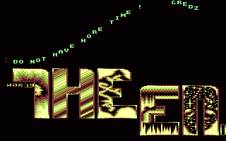
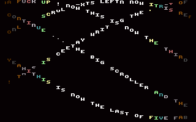
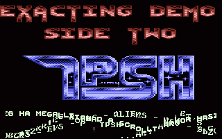
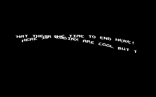

# DYCP

- Source: https://plus4world.powweb.com/plus4encyclopedia/500011
- Category: Glossary/Demos
- Keywords: dycp,megadycp,bitmap scrolling See Also DYPP, DXCP

A DYCP is an somewhat common effect used in demos. It stands for Different Y Character Position. It's basically a line of text where each character is displayed in a different Y position, that is, a little bit above or below the previous ones. (Usually sinus tables are used.)

This effect was probably first created in a character matrix, using a 32x8 area. When a DYCP uses the whole screen, we call it MegaDYCP.

Usually DYCP use single characters. However, there are a few that use larger letters. [Amiga Mania](https://plus4world.powweb.com/software/Amiga_Mania) by EDC for example contains a rare 4x4 DYCP.

Some DYCPs may consider to overlap each other, or do it over graphic elements in general. In that case, the acronym DYSCP (where stands for "sprite") is used.

Along all the possible variables of DYCP, the bitmap scrolling is quite a common one, where the bytes shifting per character is oddly performed into the letter itself, resulting in a sort of wobbling DYCP that would look close to a DYPP.

Examples:

A classic DYCP closes the [Overture](https://plus4world.powweb.com/software/Overture) megademo.

[Amiga Mania](https://plus4world.powweb.com/software/Amiga_Mania), bounce those big letters!

5 MegaDYCPs by [Ceekay](https://plus4world.powweb.com/members/Ceekay) from [Karateka](https://plus4world.powweb.com/software/Karateka) intro.

3 different charsets DYSCP flickering on a "TPSH" chars tag in [Exacting Demo](https://plus4world.powweb.com/software/Exacting_Demo).

Double take for a double witch: both DYSCP and bitmap scroller in the very end of [Hexen Hexen](https://plus4world.powweb.com/software/Hexen_Hexen).
