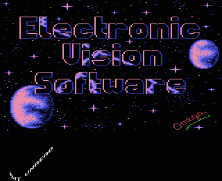
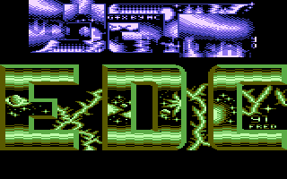

# DYPP

- Source: https://plus4world.powweb.com/plus4encyclopedia/500014
- Category: Glossary/Demos
- Keywords: dypp

A DYPP is an effect used in demos. It stands for Different Y Pixel Position. Basically a line of text is broken apart at every pixel, and is displayed in a different Y position, that is, above or below the previous columns. (Usually using a sinus table.) It's similar to DYCPs, but harder to code and more CPU intensive.

Examples:

The [EVS](https://plus4world.powweb.com/groups/EVS) part from [Crackers' Demo 2](https://plus4world.powweb.com/software/Crackers_Demo_2) features an 8 chars wide DYPP on the lower border.

MC of [EDC](https://plus4world.powweb.com/groups/EDC) shows in his [Legend of MC](https://plus4world.powweb.com/software/Legend_Of_MC) demo a 2x2 dypp shadowing over a logo.
