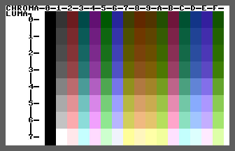

# TED Registers

- Source: https://plus4world.powweb.com/plus4encyclopedia/500024
- Category: Programming/Assembly
- Keywords: $FF00,$FF01,$FF02,$FF03,$FF04,$FF05,$FF06,$FF07,$FF08,$FF09,$FF0A,$FF0B,$FF0C,$FF0D,$FF0E,$FF0F, $FF10,$FF11,$FF12,$FF13,$FF14,$FF15,$FF16,$FF17,$FF18,$FF19,$FF1A,$FF1B,$FF1C,$FF1D,$FF1E,$FF1F, $FF3E, $FF3F

Table Of Contents:

- [Quick reference chart](#QuickRef)
- [Detailed register description](#DetailedRegs)
- [Palette](#Palette)
- [Video modes](#VideoModes)

The TED has all of its registers between memory addresses $FF00-$FF3F. Some general things to note: unused bits are always one, whatever value is written into them is ignored. E.g. write $12 into $FF15, reading it back will be $92 ($12 + $80 unused bit). Almost all registers are read/write!

Quick reference chart:

| Address | B7 | B6 | B5 | B4 | B3 | B2 | B1 | B0 | Description |
|---|---|---|---|---|---|---|---|---|---|
| [$FF00](#FF00) | TIMER1LO |  |  |  |  |  |  |  | Timer/Counter #1: low bits |
| [$FF01](#FF01) | TIMER1HI |  |  |  |  |  |  |  | Timer/Counter #1: high bits |
| [$FF02](#FF02) | TIMER2LO |  |  |  |  |  |  |  | Timer/Counter #2: low bits |
| [$FF03](#FF03) | TIMER2HI |  |  |  |  |  |  |  | Timer/Counter #2: high bits |
| [$FF04](#FF04) | TIMER3LO |  |  |  |  |  |  |  | Timer/Counter #3: low bits |
| [$FF05](#FF05) | TIMER3HI |  |  |  |  |  |  |  | Timer/Counter #3: high bits |
| [$FF06](#FF06) | TEST | ECM | BMM | DEN | RSEL | YSCROLL |  |  | Configuration Register 1 (CR1) |
| [$FF07](#FF07) | RVSDIS | NTSC/PAL[¹](#SideNote1) | TEDOFF | MCM | CSEL | XSCROLL |  |  | Configuration Register 2 (CR2) |
| [$FF08](#FF08) | KEYBOARD |  |  |  |  |  |  |  | Keyboard Latch register |
| [$FF09](#FF09) | IRQ | TIMER3IF | - | TIMER2IF | TIMER1IF | ILP[²](#SideNote2) | IRST | - | Interrupt Flags register (IRQST) |
| [$FF0A](#FF0A) | - | TIMER3IE | - | TIMER2IE | TIMER1IE | LPIE[²](#SideNote2) | ERST | RSTCMP8 | Interrupt Enable register + Raster interrupt B8 (IRQEN) |
| [$FF0B](#FF0B) | RSTCMP7..0 |  |  |  |  |  |  |  | Raster Interrupt bits B7..0 |
| [$FF0C](#FF0C) | - |  |  |  |  |  | CURSORHI |  | Cursor position: high 2 bits |
| [$FF0D](#FF0D) | CURSORLO |  |  |  |  |  |  |  | Cursor position: low 8 bits |
| [$FF0E](#FF0E) | SND1FREQLO |  |  |  |  |  |  |  | Sound Channel #1 frequency: low 8 bits |
| [$FF0F](#FF0F) | SND2FREQLO |  |  |  |  |  |  |  | Sound Channel #2 frequency: low 8 bits |
| [$FF10](#FF10) | - |  |  |  |  |  | SND2FREQHI |  | Sound Channel #2 frequency: high 2 bits |
| [$FF11](#FF11) | SNDDC | SND2NOISE | SND2ON | SND1ON | VOLUME |  |  |  | Sound control register (SCR) |
| [$FF12](#FF12) | - |  | BMPADDR |  |  | BMPROM | SND1FREQHI |  | Bitmap address, BMP+CHAR ROM/RAM, Sound Channel #1 frequency: high 2 bits |
| [$FF13](#FF13) | Character generator address |  |  |  |  |  | SINGLECLK | ROM/RAM[³](#SideNote3) | Character generator address, Single clock mode, actual ROM/RAM config |
| [$FF14](#FF14) | Screen memory address |  |  |  |  | - |  |  | Screen memory address |
| [$FF15](#FF15) | - | LUMA |  |  | CHROMA |  |  |  | Background luminance+chrominance 0 (B0C) |
| [$FF16](#FF16) | - | LUMA |  |  | CHROMA |  |  |  | Background luminance+chrominance 1 (B1C) |
| [$FF17](#FF17) | - | LUMA |  |  | CHROMA |  |  |  | Background luminance+chrominance 2 (B2C) |
| [$FF18](#FF18) | - | LUMA |  |  | CHROMA |  |  |  | Background luminance+chrominance 3 (B3C) |
| [$FF19](#FF19) | - | LUMA |  |  | CHROMA |  |  |  | Border luminance+chrominance (EC) |
| [$FF1A](#FF1A) | - |  |  |  |  |  | STCHPOSHI |  | Start position of character row: high 2 bits |
| [$FF1B](#FF1B) | STCHPOSLO |  |  |  |  |  |  |  | Start position of character row: low 8 bits |
| [$FF1C](#FF1C) | - |  |  |  |  |  |  | RSTL8 | Current vertical position: high 1 bit |
| [$FF1D](#FF1D) | RSTL7..0 |  |  |  |  |  |  |  | Current vertical position: low 8 bits |
| [$FF1E](#FF1E) | LINEPOS7..0 |  |  |  |  |  |  | - | Current horizontal position: high 7 bits |
| [$FF1F](#FF1F) | - | FLASHCNT |  |  |  | CHRAST |  |  | Flash counter, actual rasterline in a character row |
| [$FF3E](#FF3E) | SWITCHROM |  |  |  |  |  |  |  | Switch to ROM on $8000..$FFFF area |
| [$FF3F](#FF3F) | SWITCHRAM |  |  |  |  |  |  |  | Switch to RAM on $8000..$FFFF area |

¹: NTSC/PAL: TED handles two video standards, but there are other differences between PAL/NTSC machines. The most important is the basic clock speed of the system. Switching the TED to the other standard will not have the desired effect, as the rest of the machine will not be replaced.
²: ILP/LPIE: The lightpen is only a planned option, unfortunately it is not implemented in TED and cannot be used.
³: ROM/RAM: The ROM/RAM can be switched with the $FF3E/$FF3F registers, this bit is read only and indicates the current state.

Detailed register description:

| $FF00..$FF05 |  |  |  |  |  |  |  |  |  |
|---|---|---|---|---|---|---|---|---|---|
| Address | B7 | B6 | B5 | B4 | B3 | B2 | B1 | B0 | Description |
| $FF00 | TIMER1LO |  |  |  |  |  |  |  | Timer/Counter #1: low bits |
| $FF01 | TIMER1HI |  |  |  |  |  |  |  | Timer/Counter #1: high bits |
| $FF02 | TIMER2LO |  |  |  |  |  |  |  | Timer/Counter #2: low bits |
| $FF03 | TIMER2HI |  |  |  |  |  |  |  | Timer/Counter #2: high bits |
| $FF04 | TIMER3LO |  |  |  |  |  |  |  | Timer/Counter #3: low bits |
| $FF05 | TIMER3HI |  |  |  |  |  |  |  | Timer/Counter #3: high bits |

- **$FF00-$FF01**: TED timer/counter #1. This 16 bit register counts back from the last value that is written to it.
- **$FF02-$FF03**: TED timer/counter #2. It runs freely from $FFFF.
- **$FF04-$FF05**: TED timer/counter #3. It runs freely from $FFFF.

These timers operate from the single clock and have no other configuration options. Timers should be set as follows: The lower 8 bits of the value must be writen first, at which point the timer stops running. Then write the upper 8 bits of the value, and the timer will start counting down from the 16-bit value.

These timers operate from the single clock, but - of course - it can also be set when the CPU is running at twice clock. This should not cause any problems, but here's what you need to know: the timers cannot be started half a clock cycle out of sync with their own clock.

The first timer is the classic interval timer: the counter counts down to 0, sets the interrupt flag, and writes the set value back to the counter. And it is repeated forever. The timer generates an interrupt after exactly as many steps (single clocks) as the value set! (If 1000 is set as the start value, there will be one interrupt every 1000 (single) clock cycles.)

The other two timers are of the one-shot like type: the set value is counted down to 0 and then sets the interrupt flag. However, it doesn't stop here like a traditional one-shot timer, but turns over to $FFFF and continues counting from there. If not re-set at this time, it will cause an interrupt again after 65535 cycles.

Timers always set the interrupt flag when they expire, regardless of whether the timer interrupt is enabled! For this reason, the expiry of timers can be checked directly from software, without the need to trigger a real interrupt. (Of course, care must be taken that the interrupt routine triggered by another event does not clear the interrupt flag of that timer.) For timer interrupt enable / flags, see the description of the [$FF09](#FF09) + [$FF0A](#FF0A) registers below.

**Note**
When setting the timer, do not allow too much time to elapse between setting the lower value (when the counter stops) and setting the upper value. The TED datasheet recommends that the time between setting the lower and upper values should be no more than 125us (approximately 110 single-clock cycles).

If too long a time elapses in the stopped state, all bits in the stopped timer value will eventually drop to 0 and the timer will remain stopped at $0000. For timers 1 and 3, this can take several seconds, but may be as little as 0.5 seconds. For timer 2, it takes roughly twice as long as the other timers for this to happen. The time taken appears to depend on the temperature of the TED chip, warmer=faster. When all bits in the stopped timer drop to 0, the corresponding interrupt flag in $FF09 will be set and cannot be cleared until after the timer is restarted.

When the timer is restarted after the bits have dropped to $0000, the previously written lower value is forgotten, and the timer will start counting from $XX00. However, this does not affect the reload value on timer 1. For example: after writing $78 to the lower value of timer 1, then waiting for the stopped timer 1 bits to drop to $0000, then restarting by writing $45 to the upper value of timer 1, it will start counting down from $4500, but it will still correctly reload at $4578 for the next interval.

| $FF06 |  |  |  |  |  |  |  |  |
|---|---|---|---|---|---|---|---|---|
| B7 | B6 | B5 | B4 | B3 | B2 | B1 | B0 | Description |
| TEST | ECM | BMM | DEN | RSEL | YSCROLL |  |  | Configuration Register 1 (CR1) |
| 0 | 0 | 0 | 1 | 1 | 0 | 1 | 1 | (Default value) |

**$FF06**: Default $1B (Similar to VIC-II $D011)

- Bit 7 : TEST, TED's internal test, it should be 0.
- Bit 6 : ECM, Extended color mode, see also $FF16/$FF17/$FF18.
- Bit 5 : BMM, Bitmap mode (0 (default) = character mode), 1 = bitmap mode)
- Bit 4 : DEN, Blank screen (Display ENable, 0 = screen is blank, 1 (default) = screen is visible)
- Bit 3 : RSEL, 25/24 rows screen
- Bit 2,1,0 : YSCROLL, Vertical smooth-scrolling

| $FF07 |  |  |  |  |  |  |  |  |
|---|---|---|---|---|---|---|---|---|
| B7 | B6 | B5 | B4 | B3 | B2 | B1 | B0 | Description |
| RVSDIS | NTSC/PAL[¹](#SideNote1) | TEDOFF | MCM | CSEL | XSCROLL |  |  | Configuration Register 2 (CR2) |
| 0 | 0 | 0 | 0 | 1 | 0 | 0 | 0 | (Default value / PAL machines) |
| 0 | 1 | 0 | 0 | 1 | 0 | 0 | 0 | (Default value / NTSC machines) |

**$FF07**: Default $08/$48 PAL/NTSC (Similar to VIC-II $D016)

- Bit 7 : RVSDIS, Inverse/256 characters flag (0 (default) = 128 characters + inverse, 1 = 256 characters)
- Bit 6 : NTSC/PAL (0 = PAL, 1 = NTSC – it has no effect in Drean machines. Note: just switching the bit will not change the machine to the other video standard!)
- Bit 5 : TEDOFF, TED stop. If set, the TED stops it's counters and screen-generating, only single clock and refresh cycles remain.
- Bit 4 : MCM, Multicolor mode
- Bit 3 : CSEL, 40/38 columns screen
- Bit 2,1,0 : XSCROLL, Horizontal smooth-scrolling

Turning on Enhanced color mode and Multicolor mode at the same time will produce black in the screen area as it does in VIC-II.

| $FF08 |  |  |  |  |  |  |  |  |
|---|---|---|---|---|---|---|---|---|
| B7 | B6 | B5 | B4 | B3 | B2 | B1 | B0 | Description |
| KEYBOARD |  |  |  |  |  |  |  | Keyboard Latch register |

**$FF08**: Keyboard input latch. Giving a strobe - writing to the register, the latch stores the values of the input-lines. Then, we can read them from this register. See [this topic](500012_plus_4_keyboard_joystick_matrix.md) for more details and a working example.

| $FF09 |  |  |  |  |  |  |  |  |
|---|---|---|---|---|---|---|---|---|
| B7 | B6 | B5 | B4 | B3 | B2 | B1 | B0 | Description |
| IRQ | TIMER3IF | - | TIMER2IF | TIMER1IF | ILP[²](#SideNote2) | IRST | - | Interrupt Flags register (IRQST) |

**$FF09**: Interrupt flags register. When a counter/raster interrupt wants to send an IRQ, its bit will appear as a 1; then, if the IRQ was caused the highest bit is set. The relevant bits are set when the conditions for interrupts are met regardless of whether the interrupt for that bit is enabled in $FF0A register.

- Bit 7 : IRQ, Interrupt occured. This bit is set when an IRQ was enabled and therefore, the IRQ was sent to the processor. Physically, this is the negated level of the TED's IRQ output. The IRQ should be deleted with writing the register-value back after accepting an interrupt.
- Bit 6 : TIMER3IF, Counter #3
- Bit 5 : Unused
- Bit 4 : TIMER2IF, Counter #2
- Bit 3 : TIMER1IF, Counter #1
- Bit 2 : ILP, Lightpen. Not implemented.
- Bit 1 : IRST, Raster-counter
- Bit 0 : Unused

The usual way to clear the interrupt flag(s) is the **LDA $FF09** / **STA $FF09** instruction pair, in which case the write to the register will clear the flag(s). When the register is written, only the flag with a bit 1 in the BYTE written is cleared! This causes an **LDA #$FF** / **STA $FF09** to delete all flags. Occasionally you may need to delete just one flag, it is also simple: for example, the **LDA #$02** / **STA $FF09** pair can be used to clear the raster interrupt flag only, leaving the other flags intact and separately handled.

| $FF0A |  |  |  |  |  |  |  |  |
|---|---|---|---|---|---|---|---|---|
| B7 | B6 | B5 | B4 | B3 | B2 | B1 | B0 | Description |
| - | TIMER3IE | - | TIMER2IE | TIMER1IE | LPIE[²](#SideNote2) | ERST | RSTCMP8 | Interrupt Enable register + Raster interrupt B8 (IRQEN) |
| 1 | 0 | 1 | 0 | 0 | 0 | 1 | 0 | (Default value) |

**$FF0A**: Interrupt mask register. These bits could be used to disable and enable interrupt-sources. When a place is set to 1, that will be able to cause an interrupt to the processor. If not, the sign of the interrupt request will only be appear in $FF09 register.

- Bit 7 : Unused
- Bit 6 : TIMER3IE, Counter #3
- Bit 5 : Unused
- Bit 4 : TIMER2IE, Counter #2
- Bit 3 : TIMER1IE, Counter #1
- Bit 2 : LPIE, Lightpen. Not implemented.
- Bit 1 : ERST, Raster-counter
- Bit 0 : RSTCMP8, 9th bit of $FF0B (see there)

| $FF0B |  |  |  |  |  |  |  |  |
|---|---|---|---|---|---|---|---|---|
| B7 | B6 | B5 | B4 | B3 | B2 | B1 | B0 | Description |
| RSTCMP7..0 |  |  |  |  |  |  |  | Raster Interrupt bits B7..0 |

**$FF0B**: Raster interrupt register. Same as VIC-II $D012 when writing; it stores the position of occurring raster interrupt. Highmost bit is in $FF0A's bit 0.

When the raster line counter reaches this value, the raster interrupt flag is set, regardless of whether or not the raster IRQ is enabled! See [$FF09](#FF09) + [$FF0A](#FF0A) registers above.

| $FF0C/$FF0D |  |  |  |  |  |  |  |  |  |
|---|---|---|---|---|---|---|---|---|---|
| Address | B7 | B6 | B5 | B4 | B3 | B2 | B1 | B0 | Description |
| $FF0C | - |  |  |  |  |  | CURSORHI |  | Cursor position: high 2 bits |
| $FF0D | CURSORLO |  |  |  |  |  |  |  | Cursor position: low 8 bits |

**$FF0C-$FF0D**: Hardware-cursor position (10 bits). Lower bits: $FF0D, higher 2 bits in $FF0C's 0th and 1st places. Beyond 1000 the cursor is not visible. However, screen manipulating tricks may cause it to be seen.
**$FF0C**:

- Bit 7-2 : Unused
- Bit 1-0 : Cursor position higher bits

**$FF0D**:

- Bit 7-0 : Cursor position lower bits

| $FF0E |  |  |  |  |  |  |  |  |
|---|---|---|---|---|---|---|---|---|
| B7 | B6 | B5 | B4 | B3 | B2 | B1 | B0 | Description |
| SND1FREQLO |  |  |  |  |  |  |  | Sound Channel #1 frequency: low 8 bits |

**$FF0E**: This register is the first sound-source's frq-value's lowmost 8 bit. More 2 bits are in $FF10's 0th and 1st places.

| $FF0F |  |  |  |  |  |  |  |  |
|---|---|---|---|---|---|---|---|---|
| B7 | B6 | B5 | B4 | B3 | B2 | B1 | B0 | Description |
| SND2FREQLO |  |  |  |  |  |  |  | Sound Channel #2 frequency: low 8 bits |

**$FF0F**: 2nd source, lowmost 8 bits. More 2 bits in $FF12, 0. and 1. places. The sound-register value can be calculated as
reg = 1023-(111860.78125/frq[Hz]) (NTSC)
reg = 1023-(110840.46875/frq[Hz]) (PAL – that constant was calculated with assuming the crystal frequency to be 17.734475MHz)
The formulae below, that can be found in various books, is wrong
reg=1024-(111860.781/frq[Hz]) (NTSC)
reg=1024-(111840.45 /frq[Hz]) (PAL)
The frequency constant in the above formulae is 1/160th of the crystal frequency for PAL and 1/128th for NTSC.
A strange thing is that the lowest tone is generated by the highest register value (1023=$3FF).
Even more weird is that the value 1022 ($3FE) locks up the corresponding sound source.

| $FF10 |  |  |  |  |  |  |  |  |
|---|---|---|---|---|---|---|---|---|
| B7 | B6 | B5 | B4 | B3 | B2 | B1 | B0 | Description |
| - |  |  |  |  |  | SND2FREQHI |  | Sound Channel #2 frequency: high 2 bits |

**$FF10**: 2nd sound-source, highmost 2 bits.

- Bit 7-2 : Unused.
- Bit 1-0 : 2nd. channel freq., highmost bits

| $FF11 |  |  |  |  |  |  |  |  |
|---|---|---|---|---|---|---|---|---|
| B7 | B6 | B5 | B4 | B3 | B2 | B1 | B0 | Description |
| SNDDC | SND2NOISE | SND2ON | SND1ON | VOLUME |  |  |  | Sound control register (SCR) |

**$FF11**: Sound control register.

- Bit 7 : SNDDC, D/A mode. See above for more.
- Bit 6 : SND2NOISE, Sound #2 noise on/off. If you set both, the square will sound.
- Bit 5 : SND2ON, Sound #2 square-wave on/off.
- Bit 4 : SND1ON, Sound #1 on/off.
- Bit 3-0 : VOLUME, sound volume. Maximum value is 8.

| $FF12 |  |  |  |  |  |  |  |  |
|---|---|---|---|---|---|---|---|---|
| B7 | B6 | B5 | B4 | B3 | B2 | B1 | B0 | Description |
| - |  | BMPADDR |  |  | BMPROM | SND1FREQHI |  | Bitmap address, BMP+CHAR ROM/RAM, Sound Channel #1 frequency: high 2 bits |
| 1 | 1 | 0 | 0 | 0 | 1 | 0 | 0 | (Default value) |

**$FF12**:

- Bit 7-6 : Unused.
- Bit 5,4,3 : BMPADDR, these bits tell, where to find bitmap in the memory when using bitmap-mode. TED assumes them as A15, A14 and A13 bits. So, the bitmaps can be switched as 8K pages, anywhere in the 64K.
- Bit 2 : BMPROM, character generator in ROM or RAM. When set, TED will enable ROM when trying to get data from the character generator or bitmap to build screen. Else, it will give out control-signals to the DRAMs.
- Bit 1,0 : SND1FREQHI, 1st sound-source, highmost bits.

| $FF13 |  |  |  |  |  |  |  |  |
|---|---|---|---|---|---|---|---|---|
| B7 | B6 | B5 | B4 | B3 | B2 | B1 | B0 | Description |
| Character generator address |  |  |  |  |  | SINGLECLK | ROM/RAM[³](#SideNote3) | Character generator address, Single clock mode, actual ROM/RAM config |
| 1 | 1 | 0 | 1 | 0 | 0 | 0 | 1 | (Default value) |

**$FF13**:

- Bit 7-2 : Character generator. Bit 7 corresponds to A15, 6 to A14 and so on. This value shows and sets the start of the character generator. It can be paged as $400 bytes. Use with addition of $FF12 bit 2.
- Bit 1 : SINGLECLK, force single clock mode. Then, TED will disable generating twice clock. Note: by default 0, twice clock is enabled. Twice clock is handled fully automatically: when TED does not need the memory, it automatically switches the CPU to double speed.
- Bit 0 : ROM/RAM, a sign to having control about memory paging. This bit always sets to 1 when ROM is active over $8000. Else, it will be 0. READ ONLY.

| $FF14 |  |  |  |  |  |  |  |  |
|---|---|---|---|---|---|---|---|---|
| B7 | B6 | B5 | B4 | B3 | B2 | B1 | B0 | Description |
| Screen memory address |  |  |  |  | - |  |  | Screen memory address |
| 0 | 0 | 0 | 0 | 1 | 1 | 1 | 1 | (Default value) |

**$FF14**:

- Bit 7-3 : Start of the video-ram. Bit 7 also corresponds to the A15 line as above. So, video-ram is mappable as $800 bytes - 2K. The above $FF12 bit 2 doesn't affect this, but the actual RAM/ROM mapping (see at $FF3E/$FF3F and $FF13/0) does.
- Bit 2-0 : Unused

| $FF15..$FF19 |  |  |  |  |  |  |  |  |  |
|---|---|---|---|---|---|---|---|---|---|
| Address | B7 | B6 | B5 | B4 | B3 | B2 | B1 | B0 | Description |
| $FF15 | - | LUMA |  |  | CHROMA |  |  |  | Background luminance+chrominance 0 (B0C) |
| $FF16 | - | LUMA |  |  | CHROMA |  |  |  | Background luminance+chrominance 1 (B1C) |
| $FF17 | - | LUMA |  |  | CHROMA |  |  |  | Background luminance+chrominance 2 (B2C) |
| $FF18 | - | LUMA |  |  | CHROMA |  |  |  | Background luminance+chrominance 3 (B3C) |
| $FF19 | - | LUMA |  |  | CHROMA |  |  |  | Border luminance+chrominance (EC) |

Color registers. Each color register has the following bits:

- Bit 7 : unused.
- Bits 6-4 : luminance
- Bits 3-0 : chrominance (color code)

These registers set the following colors:

- **$FF15** : Background color. Works/used in every video mode.
- **$FF16** : Multicolor/Extended color #1. Works/used in multicolor and ECM modes, see $FF07 and $FF06.
- **$FF17** : Multicolor/Extended color #2. Works/used in multicolor and ECM modes, see $FF07 and $FF06.
- **$FF18** : Extended color #3. Works/used in ECM mode only, see $FF06.
- **$FF19** : Border color. Works/used in every video mode. When the screen is turned off, (see $FF06), the whole screen is this color.

| $FF1A/$FF1B |  |  |  |  |  |  |  |  |  |
|---|---|---|---|---|---|---|---|---|---|
| Address | B7 | B6 | B5 | B4 | B3 | B2 | B1 | B0 | Description |
| $FF1A | - |  |  |  |  |  | STCHPOSHI |  | Start position of character row: high 2 bits |
| $FF1B | STCHPOSLO |  |  |  |  |  |  |  | Start position of character row: low 8 bits |

**$FF1A**:

- Bit 7-2 : Unused
- Bit 1-0 : STCHPOSHI, Highmost bits of register $FF1B (only affects bitmap mode)

**$FF1B**: STCHPOSLO, Current character-position (only affects bitmap mode). Highmost bits in the above register. TED counts the characters that it had fetched and put out to the screen. The number is increasing by 40 after every character row (8 rasterline).

- Bit 7-0 : STCHPOSLO, Low 8 bits.

| $FF1C/$FF1D |  |  |  |  |  |  |  |  |  |
|---|---|---|---|---|---|---|---|---|---|
| Address | B7 | B6 | B5 | B4 | B3 | B2 | B1 | B0 | Description |
| $FF1C | - |  |  |  |  |  |  | RSTL8 | Current vertical position: high 1 bit |
| $FF1D | RSTL7..0 |  |  |  |  |  |  |  | Current vertical position: low 8 bits |

**$FF1C**:

- Bit 7-1 : Unused
- Bit 0 : Highmost bit of $FF1D

**$FF1D**: RSTL7..0, Current position of vertical scanning. Highmost bit is in $FF1C. Read/Writeable!

- Bit 7-0 : RSTL7..0, current raster line low 8 bits.

| $FF1E |  |  |  |  |  |  |  |  |
|---|---|---|---|---|---|---|---|---|
| B7 | B6 | B5 | B4 | B3 | B2 | B1 | B0 | Description |
| LINEPOS7..0 |  |  |  |  |  |  | - | Current horizontal position: high 7 bits |

**$FF1E**: Current position of horizontal scanning. R/W!. Lowmost bit is unused. It contains the TED's internal counter's highmost 8 bits. So, it increases by 4 with every character. When writing, it seems to put the value to a functionally different register (writing back a reading value in right time affects the screen).

- Bit 7-1 : Horizontal position
- Bit 0 : Unused

| $FF1F |  |  |  |  |  |  |  |  |
|---|---|---|---|---|---|---|---|---|
| B7 | B6 | B5 | B4 | B3 | B2 | B1 | B0 | Description |
| - | FLASHCNT |  |  |  | CHRAST |  |  | Flash counter, actual rasterline in a character row |

**$FF1F**:

- Bit 7 : Unused
- Bit 6-3 : FLASHCNT, flashing counter. It's value increases with every frame, and TED fits it's flashing feature to this register's reaching to 15.
- Bit 2,1,0 : CHRAST, actual vertical scanning-line in a character row. R/W!.

| $FF3E |  |  |  |  |  |  |  |  |
|---|---|---|---|---|---|---|---|---|
| B7 | B6 | B5 | B4 | B3 | B2 | B1 | B0 | Description |
| SWITCHROM |  |  |  |  |  |  |  | Switch to ROM on $8000..$FFFF area |

**$FF3E**: This so called "shadow register" controls RAM/ROM paging with register **$FF3F**. Writing an arbitrary value to $FF3E will page in the currently configured ROMs to the upper memory area ($8000..$FFFF).

| $FF3F |  |  |  |  |  |  |  |  |
|---|---|---|---|---|---|---|---|---|
| B7 | B6 | B5 | B4 | B3 | B2 | B1 | B0 | Description |
| SWITCHRAM |  |  |  |  |  |  |  | Switch to RAM on $8000..$FFFF area |

**$FF3F**: This so called "shadow register" controls RAM/ROM paging with register **$FF3E**. Writing an arbitrary value to $FF3F will page in the RAM to the upper memory area ($8000..$FFFF).

It seems that the memory area in the hole of the TED registers ($FF20..$FF3D) is available as ROM or RAM depending on the ROM/RAM switch.

Palette:

TED can display 121 colors on the screen. This "nice" number can be calculated as follows:

The color code consists of a 4-bit chrominance part (in the above description as CHROMA), which means 16 different colors. More precisely, 15 colors, plus black. This is complemented by a 3-bit brightness value (in the above description as LUMA), so that each color has 8 different brightness levels. The exception is black, all luminosities of which are the same black. It follows that 15 chrominances * 8 luminances = 120, + 1 black = 121.

The following picture shows this:

The color codes (in the registers) are composed so that the 6,5,4 bits are the brightness (LUMA) and the 3,2,1,0 bits are the color code (CHROMA) itself. Because of this it is very easy to represent them hexadecimally, for example $71 means that the $1 color is $7 in brightness.

Some interesting facts:

- The first 8 colors of the TED are the same as the first 8 colors of the VIC-II(e), you just need to select the closest brightness value.
- TED's white is the lightest $1 color (code: $71), but it's not actually white, just a very-very light grey. (Since the same level of brightness is given for all colors, if the white it were lighter, the other colors would be completely bleached out.) This contrasts with the white color of the VIC-II(e), which has a signal level so high that it is higher than the standard value.
- Black is darker than the darkest brightness of the other colors, so there are 9 levels of brightness in total.

Video modes:

The TED has 4 plus 1 configuration bits to switch between different modes. One of these bits should be examined separately:

| DEN   $FF06 B4 | Description |
|---|---|
| 1 | Screen on: the picture is displayed according to the mode you have set |
| 0 | Screen off: the whole screen takes on the color of the border |

When the screen is off, the CPU performs about 10000 clock cycles more during a full display frame than when the screen is on! In this case, the CPU is running at twice clock speed for almost the entire time. Warning: this setting, the CPU is not running at a constant speed! If a non-varying speed is required, the slower single clock can be enabled by setting bit 1 (SINGLECLK) of $FF13.

When the screen is on, TED reads exactly the same amount of data from memory in all of the following modes, with exactly the same timing. So a change of screen mode does not change the scheme of where the CPU runs and at what speed. (Except for the case above when the screen is turned off.) Note: because of scheduling differences between on/off screen, the DEN bit does not directly control the screen. (TED only uses the DEN bit state when it has to decide which schedule to use, etc...) For this reason, switching the control bit will not have an immediate effect, but will usually only affect the next frame.

To draw the image, TED reads data from two sources in each mode:

- Reads data from the "screen memory" area: this is a 2 KBYTE area (in two 1 KBYTE slices), which can be placed anywhere in memory (starting at 2 KBYTE boundaries), see the description of the [$FF14 register](#FF14). (If it is in the range $8000..$FFFF, reads from ROM or RAM as configured for the CPU.) From this memory, the TED reads 40+40 BYTE for each character line. (This memory area is identical in function to the VIC-II(e) screen memory + color memory.) When TED reads this memory space, it stops the CPU for that time. Each character row has two such raster rows ('DMA-lines' or 'bad-lines'), at which time it reads 40 + 40 BYTE into an internal buffer. The function of the readed BYTEs depends on the screen mode, see below for details.
- It reads in "bitmap" data, this is the character set in character mode, the actual bitmap in graphics mode, see [$FF13](#FF13) and [$FF12](#FF12) registers and [$FF06](#FF06) register for setting the video mode. (If it is in the range $8000..$FFFF, reads from ROM or RAM depending on the state of the BMPROM configuration bit, see [$FF12 Bit 2](#FF12)). That's 40 BYTE per raster line, for a total of 320 per character line. When only this data is needed by the TED, the CPU runs at a single clock speed. The data readed here will be the pixels on the screen. How depends on the mode you have set, see below.

CPU vs video speed: in single clock CPU speed, exactly 8 (HiRes) pixels of image are drawn on the screen in one clock cycle. (And 4 pixels on twice clock.) In fact, TED has 3 types of schedule:

- If it doesn't need to read anything, the CPU is running at twice clock speed
- If it only reads the 'bitmap' data, the CPU is running at single clock speed
- If you also need to read the "screen memory" (then you also need to read 'bitmap'), the CPU is stopped

**Pixels:**

The pixels are generated from the 'bitmap' data, which is read by TED from the character set in character mode and from the graphic-bitmap in graphics mode. The BYTE interpretation of the readed 'bitmap' is fortunately the same:

- In 'HiRes' mode, one BYTE represents 8 pixels, which are displayed according to the binary representation:

| B7 | B6 | B5 | B4 | B3 | B2 | B1 | B0 |
|---|---|---|---|---|---|---|---|
| #   Left-most pixel | #   . | #   . | #   . | #   . | #   . | #   . | #   Right-most pixel |

In this case, a pixel has two states:

| Bit | Pixel value |
|---|---|
| 0 | 0 or Off |
| 1 | 1 or On |

- In 'Multicolor' mode, the horizontal resolution is halved with two bits per one pixel, the display is as follows:

| B7 | B6 | B5 | B4 | B3 | B2 | B1 | B0 |
|---|---|---|---|---|---|---|---|
| ##   Left-most pixel |  | ##   . |  | ##   . |  | ##   Right-most pixel |  |

In this case, a pixel has four states:

| Bitpair | Pixel value |
|---|---|
| 00 | 0 |
| 01 | 1 |
| 10 | 2 |
| 11 | 3 |

Which pixel value corresponds to which color depends on the mode, see below.

**Configurations for the modes:**

| ECM   $FF06 B6 | BMM   $FF06 B5 | MCM   $FF07 B4 | RVSDIS   $FF07 B7 | Description |
|---|---|---|---|---|
| 0 | 0 | 0 | 0 | HiRes character mode with 128 chars, system-default |
| 0 | 0 | 0 | 1 | HiRes character mode with 256 chars |
| 1 | 0 | 0 | X | HiRes character mode with extended background colors, 64 chars |
| 0 | 0 | 1 | 0 | Multicolor character mode with 128 chars |
| 0 | 0 | 1 | 1 | Multicolor character mode with 256 chars |
| 0 | 1 | 0 | X | HiRes Bitmap mode |
| 0 | 1 | 1 | X | Multicolor Bitmap mode |
| 1 | 1 | X | X | Illegal mode (black) |
| 1 | X | 1 | X | Illegal mode (black) |

**Character modes:**

In character mode, the 'bitmap' data is read from the character set. (See [$FF13 register](#FF13).) Each character has 8 BYTEs, which describe the character's image in the 8 associated rasterlines. The address of a character in the character set can be calculated as follows: character code × 8, plus the starting address of the character set. The 8 consecutive BYTE here are the 'image' of the character.

In character mode, the "screen memory" is divided into the following two parts:

- The first 1 KBYTE contains the colors of the characters, in this case it is the 'color memory' or 'attribute memory'.
- The second 1 KBYTE contains the codes of the characters, which indicate which character should appear at the given position. This is the 'character memory' or 'character matrix'.

| HiRes character mode with 128 chars, system-default |  |  |  |
|---|---|---|---|
| ECM=0 | BMM=0 | MCM=0 | RVSDIS=0 |

In this mode, 128 different characters can be used, the character set size is 128×8 BYTE, i.e. 1 KBYTE. In this case, the address of the character set can be set with 1 KBYTE boundaries! The lower 7 bits (Bit 6-0) of the BYTE in the 'character memory' then give the character code, which in the character set indicates the character's shape. Bit 7 then indicates the inverted state of the character. TED will still read the selected character 'bitmap' (from the 0-127 character), but it will reverse the readed data itself and display it. For this reason, the shape of the inverse characters does not need to be stored separately, the inversion is done by TED.

The colors of the pixels displayed are:

| Pixel value | Color |
|---|---|
| 0 | $FF15 |
| 1 | 'Color memory' BYTE Bit 6-0 |

In this mode, you can use two colors per character: a single color for the whole screen, and a color that can be set for each character position. The BYTE 6-0 bits of the color BYTE read from 'color memory' have the usual structure: Bit 6-4: brightness, Bit 3-0: color code (chromaticity). Bit 7 turns on character flashing if 1. This flashing is also done by the TED completely independently of the CPU. In this mode, TED displays the character cursor in the set position.

| HiRes character mode with 256 chars |  |  |  |
|---|---|---|---|
| ECM=0 | BMM=0 | MCM=0 | RVSDIS=1 |

As before, but in this mode, 256 different characters can be used, the character set size is 256×8 BYTE, i.e. 2 KBYTE. In this case, the address of the character set can be set with 2 KBYTE boundaries! The entire BYTE in the 'character memory' then give the character code, which in the character set indicates the character's shape.

The colors of the pixels displayed are the same as the previous ones, which are:

| Pixel value | Color |
|---|---|
| 0 | $FF15 |
| 1 | 'Color memory' BYTE Bit 6-0 |

In this mode, you can use two colors per character: a single color for the whole screen, and a color that can be set for each character position. The BYTE 6-0 bits of the color BYTE read from 'color memory' have the usual structure: Bit 6-4: brightness, Bit 3-0: color code (chromaticity). Bit 7 turns on character flashing if 1. This flashing is also done by the TED completely independently of the CPU. In this mode, TED displays the character cursor in the set position.

| HiRes character mode with extended background colors, 64 chars |  |  |  |
|---|---|---|---|
| ECM=1 | BMM=0 | MCM=0 | RVSDIS=X |

In this mode, 64 different characters can be used, the character set size is 64×8 BYTE, i.e. 0.5 KBYTE. In this case - unfortunately - the RVSDIS is ineffective, the character set can be set within 2 KBYTE boundaries. Since only 64 characters can be used, the 2 bits freed from the character code (Bit 7, 6) are assigned to the background color.

The colors of the pixels displayed are:

| Pixel value | Character code Bit 7,6 | Color |
|---|---|---|
| 0 | 00 | $FF15 |
| 0 | 01 | $FF16 |
| 0 | 10 | $FF17 |
| 0 | 11 | $FF18 |
| 1 | XX | 'Color memory' BYTE Bit 6-0 |

In this mode, you can use two colors per character: a single color for the whole screen, and a color that can be set for each character position. The BYTE 6-0 bits of the color BYTE read from 'color memory' have the usual structure: Bit 6-4: brightness, Bit 3-0: color code (chromaticity). Bit 7 is not used in this mode, its value is irrelevant. In this mode, TED does not display the character cursor!

| Multicolor character mode with 128 chars |  |  |  |
|---|---|---|---|
| ECM=0 | BMM=0 | MCM=1 | RVSDIS=0 |

In this mode, 128 different characters can be used, the character set size is 128×8 BYTE, i.e. 1 KBYTE. In this case, the address of the character set can be set with 1 KBYTE boundaries! The lower 7 bits (Bit 6-0) of the BYTE in the 'character memory' then give the character code, which in the character set indicates the character's shape. Bit 7 is not used in this mode, its value is irrelevant.

The colors of the pixels displayed are:

| Pixel value | Color |
|---|---|
| 00 | $FF15 |
| 01 | $FF16 |
| 10 | $FF17 |
| 11 | 'Color memory' BYTE Bit 6-4, 2-0 |

In this mode, you can use four colors per character: three color for the whole screen, and a color that can be set for each character position. Bits 6-0 of the BYTE read from 'color memory' are partly of the usual structure, Bit 6-4: brightness. However, the color code (chromaticity) is only 3 bits: Bit 2-0. For this reason, only the first 8 colors can be used (with all brightness values)! The bit 3 taken from the color code can be used to switch the character to HiRes or Multicolor mode! (Bit 3 = 0: HiRes, = 1: Multicolor.) This can be used to mix HiRes / Multicolor characters on the screen, and display both at the same time. (This function of bit 3 is unfortunately a legacy of VIC/VIC-II, where it is used for the same function. In TED, however, there is an unused bit in the BYTE of the color code that could have been used for this function...) Bit 7 is not used in this mode, its value is irrelevant. In this mode, TED does not display the character cursor!

| Multicolor character mode with 256 chars |  |  |  |
|---|---|---|---|
| ECM=0 | BMM=0 | MCM=1 | RVSDIS=1 |

As before, in this mode, 256 different characters can be used, the character set size is 256×8 BYTE, i.e. 2 KBYTE. In this case, the address of the character set can be set with 2 KBYTE boundaries! The entire BYTE in the 'character memory' then give the character code, which in the character set indicates the character's shape.

The colors of the pixels displayed are:

| Pixel value | Color |
|---|---|
| 00 | $FF15 |
| 01 | $FF16 |
| 10 | $FF17 |
| 11 | 'Color memory' BYTE Bit 6-4, 2-0 |

In this mode, you can use four colors per character: three color for the whole screen, and a color that can be set for each character position. Bits 6-0 of the BYTE read from 'color memory' are partly of the usual structure, Bit 6-4: brightness. However, the color code (chromaticity) is only 3 bits: Bit 2-0. For this reason, only the first 8 colors can be used (with all brightness values)! The bit 3 taken from the color code can be used to switch the character to HiRes or Multicolor mode! (Bit 3 = 0: HiRes, = 1: Multicolor.) This can be used to mix HiRes / Multicolor characters on the screen, and display both at the same time. Bit 7 is not used in this mode, its value is irrelevant. In this mode, TED does not display the character cursor!

**Graphic modes:**

In graphic mode, the 'bitmap' data is read from the (real) bitmap. Its size is 8 KBYTE, freely movable in memory along 8 KBYTE boundaries. (See [$FF12 register](#FF12).) Its structure is similar to the character set of the character mode, the consecutive 8 BYTEs give the shape of one character area (8×8 pixels). Of these 8 BYTE groups, 40 give the complete picture of a character row.

In graphical mode, "screen memory" can also be called "attribute memory" as a whole. It is divided into the following two parts:

- The first 1 KBYTE of data contains brightness values (LUMAs) for two freely adjustable colors. This is the "luma memory".
- The second 1 KBYTE of data contains chromination values (CHROMAs) for two freely adjustable colors. This is the "chroma memory".

A BYTE of LUMA memory and a BYTE of CHROMA memory, paired with each other, contains two colors of a character area, which may vary from character area to character area.

| HiRes Bitmap mode |  |  |  |
|---|---|---|---|
| ECM=0 | BMM=1 | MCM=0 | RVSDIS=X |

In this mode, each pixel of the entire screen can be turned on/off separately (320×200 pixels). Each bit corresponds to one pixel.

The colors of the pixels displayed are:

| Pixel value | Color |
|---|---|
| 0 | LUMA BYTE bit 6-4 + CHROMA BYTE bit 3-0 |
| 1 | LUMA BYTE bit 2-0 + CHROMA BYTE bit 7-4 |

In this mode, two colors can be used per character, both freely selectable. Bits 7 and 4 of the LUMA BYTE are not used.

| Multicolor Bitmap mode |  |  |  |
|---|---|---|---|
| ECM=0 | BMM=1 | MCM=1 | RVSDIS=X |

In this mode, each pixel of the entire screen can be turned on/off separately (160×200 pixels). Each bitpair (two bit) corresponds to one pixel.

The colors of the pixels displayed are:

| Pixel value | Color |
|---|---|
| 00 | $FF15 |
| 01 | LUMA BYTE bit 2-0 + CHROMA BYTE bit 7-4 |
| 10 | LUMA BYTE bit 6-4 + CHROMA BYTE bit 3-0 |
| 11 | $FF16 |

In this mode, four colors per character can be used, two of which can be freely selected. (This is different from the VIC-II, where the 12 bits of attribute memory can hold 3 color codes, whereas the TED has only two in the 16 bits of attribute memory.) Bits 7 and 4 of the LUMA BYTE are not used.
