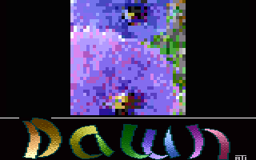

# FLI

- Source: https://plus4world.powweb.com/plus4encyclopedia/500027
- Category: Glossary/Demos
- Keywords: fli,dfli,double line fli,quad fli,qfli,zoom4

This is going to be a very interesting topic. Feel free to add stuff until we get things right.

FLI is an acronym that stands for Flexible Line Interlace/Interleave/Interpretation. The term originates from the C64 scene. On the Plus/4 scene, it's used wildly, perhaps it's time to lay down some "standard" definitions.

On the Plus/4, the color information (color map) is fetched every 8 raster lines. FLI means telling the TED to fetch it every line instead, this means basically adjusting the $FF14 TED register. Because it's fetched every SINGLE line, we can call this Single Line FLI. This is the basic FLI. On the C64 this works well, but on the Plus/4 it doesn't, because to fetch the whole information, two lines are needed. *Explain Single Line FLI sideeffect.

Examples:


An early example of hires interlaced FLI on Plus/4, taken from [Larry](https://plus4world.powweb.com/members/Larry)'s [Gif Collection](https://plus4world.powweb.com/software/Gif_Collection).

To do a proper FLI, we can only change the color map every second line, hence the name Double Line FLI, or DFLI. With this method, we can have 8 different colors per character instead of the normal 2.


One of the astonishing pictures shown in the DFLI picture show [Drea-M-time XXXII](https://plus4world.powweb.com/software/Drea-M-time_XXXII), released by [Larry](https://plus4world.powweb.com/members/Larry), once the technique has been figured out.

Doing the same but in Hires mode can take to some very detailed results, especially by interlacing multiple bitmaps.


Straight from the compo winning [Dreamtime 2K18](https://plus4world.powweb.com/software/Dreamtime_2K18), interlaced Hires graphics has never been so coloured!

If we change the color map every 4th line, that could be called Quad FLI, but the name ZOOM4 is also used.


[Ati](https://plus4world.powweb.com/members/Ati)'s way to use the Zoom4: a bitmap rotator, as seen on Crackers'Demo 4.

---
[Degauss](https://plus4world.powweb.com/members/Degauss)/[TEK](https://plus4world.powweb.com/groups/TEK)'s words allow a deeper probing into Plus/4 FLI modes.
---
TED has internal memory: two times 40 bytes. In character mode this means: 40 bytes for the colors, 40 bytes for the characters.
Everytime the lower three bits of $FF06 matches $FF1D, TED fills its internal memory from RAM. this is called the DMA-cycle.
This adds for speed during display: TED loads this info once, reuses it 8 times in a row, it doesn't block RAM-access for the CPU.
This is, what in a Badline happens: TED suspends the CPU to get access to RAM, in order to fill its internal memory. But basically, remember this: everytime that the Badline thing happens, CPU is stalled. You only have 20-something cycles left instead of 65 in this 40 cycles its happening. TED "reloads" its internal memory from RAM, you change $FF14, AND you change $FF06 to match $FF1D. The reload is going to happen! That would mean: changing the foreground-color every line TED doesn't care whats in $FF14 unless it comes accross its "crucial point" where it knows: "hey, i need to fetch the next colors/chars". Thats the internal logic: "fetch color and character-data when $FF06 = $FF1D".
$FF1D changes from rasterline to rasterline. We're still talking about a per-line-based effect. $FF1D holds the counter for the rasterline, you don't have to modify it.

Example:
```asm
LDA sometable,Y
STA $FF06
LDA someothertable,Y
STA $FF14
INY
CPY #$C8
BNE .loop
```

if you count, you see 23 cycles.
---

Standard
line 0 FF06 = 00 FF14 = 08 TED fetches color information from RAM ( (FF06 & $03) = (FF1D & $03) )
line 1 FF06 = 00 ; FF14 = 08 TED fetches character information from RAM (the second part of the "DMA-cycle")
line 2 FF06 = 00 ; FF14 = 08 -
line 3 FF06 = 00 ; FF14 = 08 -
line 4 FF06 = 00 ; FF14 = 08 -
line 5 FF06 = 00 ; FF14 = 08 -
line 6 FF06 = 00 ; FF14 = 08 -
line 7 FF06 = 00 ; FF14 = 08 -

line 8 FF06 = 00 ; FF14 = 08 TED fetches color information from RAM ( (FF06 & $03) = (FF1D & $03) )
line 9 FF06 = 00 ; FF14 = 08 TED fetches character information from RAM (the second part of the "DMA-cycle")
line a FF06 = 00 ; FF14 = 08 -
...

FLI
line 0 FF06 = 00 ; FF14 = 08 TED fetches color information from RAM ( (FF06 & $03) = (FF1D & $03) )
line 1 FF06 = 01 ; FF14 = 10 TED fetches color information from RAM ( (FF06 & $03) = (FF1D & $03) )
line 2 FF06 = 02 ; FF14 = 18 TED fetches color information from RAM ( (FF06 & $03) = (FF1D & $03) )
line 3 FF06 = 03 ; FF14 = 20 TED fetches color information from RAM ( (FF06 & $03) = (FF1D & $03) )
line 4 FF06 = 04 ; FF14 = 28 TED fetches color information from RAM ( (FF06 & $03) = (FF1D & $03) )
line 5 FF06 = 05 ; FF14 = 30 TED fetches color information from RAM ( (FF06 & $03) = (FF1D & $03) )
line 6 FF06 = 06 ; FF14 = 38 TED fetches color information from RAM ( (FF06 & $03) = (FF1D & $03) )
line 7 FF06 = 07 ; FF14 = 40 TED fetches color information from RAM ( (FF06 & $03) = (FF1D & $03) )

line 8 FF06 = 00 ; FF14 = 08 TED fetches color information from RAM ( (FF06 & $03) = (FF1D & $03) )
line 9 FF06 = 01 ; FF14 = 10 TED fetches color information from RAM ( (FF06 & $03) = (FF1D & $03) )
line A FF06 = 02 ; FF14 = 18 TED fetches color information from RAM ( (FF06 & $03) = (FF1D & $03) )
...

DFLI
line 0 FF06 = 00 ; FF14 = 08 TED fetches color information from RAM ( (FF06 & $03) = (FF1D & $03) )
line 1 FF06 = 00 ; FF14 = 08 TED fetches character information from RAM (the second part of the "DMA-cycle")
line 2 FF06 = 02 ; FF14 = 10 TED fetches color information from RAM ( (FF06 & $03) = (FF1D & $03) )
line 3 FF06 = 02 ; FF14 = 10 TED fetches character information from RAM (the second part of the "DMA-cycle")
line 4 FF06 = 04 ; FF14 = 18 TED fetches color information from RAM ( (FF06 & $03) = (FF1D & $03) )
line 5 FF06 = 04 ; FF14 = 18 TED fetches character information from RAM (the second part of the "DMA-cycle")
line 6 FF06 = 06 ; FF14 = 20 TED fetches color information from RAM ( (FF06 & $03) = (FF1D & $03) )
line 7 FF06 = 06 ; FF14 = 20 TED fetches character information from RAM (the second part of the "DMA-cycle")

line 8 FF06 = 00 ; FF14 = 08 TED fetches color information from RAM ( (FF06 & $03) = (FF1D & $03) )
line 9 FF06 = 00 ; FF14 = 08 TED fetches character information from RAM (the second part of the "DMA-cycle")
line a FF06 = 02 ; FF14 = 10 TED fetches color information from RAM ( (FF06 & $03) = (FF1D & $03) )
...

ZOOM4
line 0 FF06 = 00 ; FF14 = 08 TED fetches color information from RAM ( (FF06 & $03) = (FF1D & $03) )
line 1 FF06 = 00 ; FF14 = 08 TED fetches character information from RAM (the second part of the "DMA-cycle")
line 2 FF06 = 00 ; FF14 = 08 -
line 3 FF06 = 00 ; FF14 = 08 -
line 4 FF06 = 04 ; FF14 = 10 TED fetches color information from RAM ( (FF06 & $03) = (FF1D & $03) )
line 5 FF06 = 04 ; FF14 = 10 TED fetches character information from RAM (the second part of the "DMA-cycle")
line 6 FF06 = 04 ; FF14 = 10 -
line 7 FF06 = 04 ; FF14 = 10 -

line 8 FF06 = 00 ; FF14 = 08 TED fetches color information from RAM ( (FF06 & $03) = (FF1D & $03) )
line 9 FF06 = 00 ; FF14 = 08 TED fetches character information from RAM (the second part of the "DMA-cycle")
line a FF06 = 00 ; FF14 = 08 -
