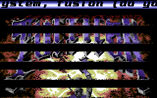

# FLD

- Source: https://plus4world.powweb.com/plus4encyclopedia/500028
- Category: Glossary/Demos
- Keywords: fld,flexible line distance,badline-delay

FLD stands for Flexible Line Distance.
Although commonly implemented as simple vertical bouncing of the screen, It allows to move bitmap or character rows in an arbitrary number of vertical raster lines apart, making it possible to arbitrarily move any 8 pixel high graphic block smoothly up and down across the screen. Adding sine curves to this positioning provided a wavy effect.
You can have variable distance between the lines, which is referred to as charlines (= 8 pixel lines). So this means top-down: 8 lines of graphics, some empty lines, another 8 lines of graphics, more empty lines, and so on.
Badline-delay means: to avoid triggering a badline manipulating $FF06 y-scroll value, and can be considered as the simpler application of FLD.
FLD effect made its first appearance on C64 in the "Think Twice" demo series, by The Judges.

Examples:

Let's slice a bitmap and let the slice bounce! It's [Friction](https://plus4world.powweb.com/software/Friction) megademo by [Ceekay](https://plus4world.powweb.com/members/Ceekay).
