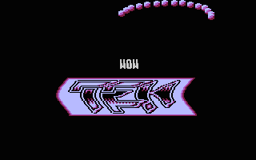
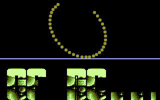
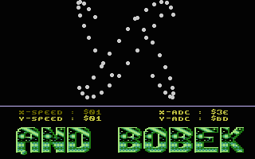
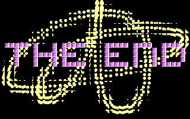

# Bobs

- Source: https://plus4world.powweb.com/plus4encyclopedia/500192
- Category: Glossary/Demos
- Keywords: bobs,bob,blitter,cyber See Also [Shadebobs](https://plus4world.powweb.com/kb.php?id=500219), [Infinite Bobs](https://plus4world.powweb.com/kb.php?id=500218), [Sprites](https://plus4world.powweb.com/kb.php?id=500228)

The word "bob" is short for Blitter Object, which were hardware sprite-like objects on the Amiga. The Plus/4 has no such thing however, so the term (as is the case with many other demoscene terms) is a bit misleading.

Simply put, bobs are moving circles (or sometimes other shapes). They are very similar to sprites, the only difference being that bobs have nothing in the background. Visually, moving circle sprites and moving circle bobs look the same, but because sprites are "on top of something", they require more code and CPU power. Bobs can also look somewhat similar to plotters. Technically, a plotter could be called a 1x1 bob effect, so bobs have to be larger than just 1 pixel.

Bob effects are usually hires, but sometimes multicolor is used.

A bob effect is good if it has lots of bobs, but also depends on the bob size: the smaller the bobs, the more that can be displayed.

Referring to Cyber vectors, called this way after they've been shown in [Camel Park](http://csdb.dk/release/?id=11652)/[CML](http://csdb.dk/group/?id=227), bobs too can be displayed in a similar way.

Examples:

15 8x8 bobs in [Brainwash](https://plus4world.powweb.com/software/Brainwash)/[TEK](https://plus4world.powweb.com/groups/TEK)

34 6x6 bobs in [Legend of MC](https://plus4world.powweb.com/software/Legend_of_MC)/[MC](https://plus4world.powweb.com/members/MC).

50 5x5 bobs in [Long Hours](https://plus4world.powweb.com/software/Long_Hours)/[Moldi](https://plus4world.powweb.com/members/Moldi).

Cyber bobs from [16 KBytes](https://plus4world.powweb.com/software/16_KBytes) demo.
