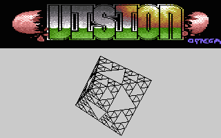
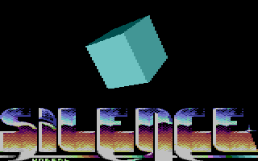
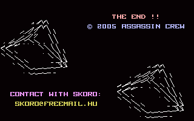
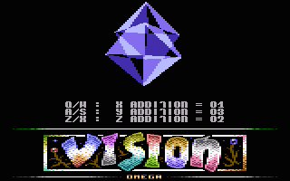

# Vectors

- Source: https://plus4world.powweb.com/plus4encyclopedia/500193
- Category: Glossary/Demos
- Keywords: vector,vectors,line,filled,solid,glenz,dots,wireframe,cyber

Vectors is a demo effect, where a 3D object is drawn on screen, either using lines or solid faces. There are a few types of vectors:
- Line vectors (or Wireframed vectors, with hidden lines or not)
- Filled vectors
- Glenz vectors
- Filled vectors (solids colors with lightshading or not)
- Dots vectors

These types can possibly sustain further distinctive characterizations, e.g. Cyber vectors, called this way after they've been shown in [Camel Park](http://csdb.dk/release/?id=11652)/[CML](http://csdb.dk/group/?id=227).

Examples:

This is one of many ways to let [EVS](https://plus4world.powweb.com/groups/EVS) burn out your TED in their monumental [Infinity](https://plus4world.powweb.com/software/Infinity) trackmo.
A big filled vectors 3D Sierpinski bounces and rotates, hiding the parts that lie behind.

Here we celebrate the scene famous [Silence](https://plus4world.powweb.com/software/Silence) megademo and his huge lightsourced filled vectors cube, performing its high performance rotation in the 6th part.

[Expectactions 2](https://plus4world.powweb.com/software/Expectation_2) says goodbye to its audience with this double cyber vectorial pyramid.

The 7th part of [Virtually Yours](https://plus4world.powweb.com/software/Virtually_Yours) megademo by [EVS](https://plus4world.powweb.com/groups/EVS) allows you to play with a glenz vectors glass hourglass.
