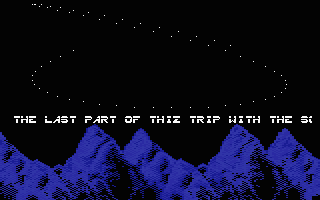
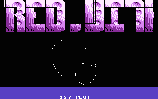
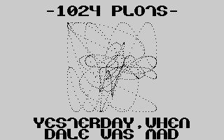
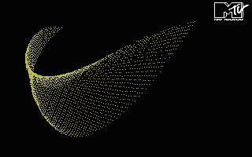

# Plotter

- Source: https://plus4world.powweb.com/plus4encyclopedia/500194
- Category: Glossary/Demos
- Keywords: plots,plotters,shadeplots,cyber,spline

A "plotter" is a demo-effect, which displays moving pixels. The pixels may appear to be a line or sometimes a 3D shape. Plotters usually appear on a clear background. A plotter could technically be called a 1x1 bob effect.

Just like Cyber vectors, called this way after they've been shown in [Camel Park](http://csdb.dk/release/?id=11652)/[CML](http://csdb.dk/group/?id=227), plotters can be displayed in a similar way too.

Examples:

[A Trip](https://plus4world.powweb.com/software/A_Trip)/[SCF](https://plus4world.powweb.com/members/SCF) had a 64 plot plotter from 1989 June.

[Imagine Megademo](https://plus4world.powweb.com/software/Imagine_Megademo) by [EDC](https://plus4world.powweb.com/groups/EDC) has 147 plots, which may be one of the highest number of plots in a plotter that is displayed realtime.

Cyber plotter from [16 KBytes](https://plus4world.powweb.com/software/16_KBytes) demo.

[Absolutely Fabulous](https://plus4world.powweb.com/software/Absolutely_Fabulous) has 1024 plots, but does not run at full frame rate. The effects only updates every 2-3 frames.

The aptly named demo [Plotter](https://plus4world.powweb.com/software/Plotter) by [TCFS](https://plus4world.powweb.com/members/TCFS) features this cool effect. It displays/erases roughly 64 plots in each frame, but the number of plots visible on the screen in obviously much higher (since they are not moving).
