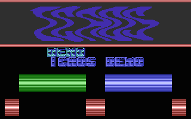
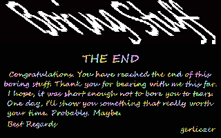

# Tech-Tech

- Source: https://plus4world.powweb.com/plus4encyclopedia/500195
- Category: Glossary/Demos
- Keywords: tech-tech,tec-tec,tic tac

Also known as Tec-tec and Tic Tac, Tech-Tech is a demo effect, where a logo (or some other graphics) is "waved", but the shift along the x-axis is greater than 8 pixels. The name **may** come from the Amiga demo Tech-Tech ([Pouet.net](http://www.pouet.net/prod.php?which=4445)). Graphics can be waved easily by modifying the $FF07 TED register for each scan line, however, this allows for only 8 pixels movement, hence the difficulty in acheiving this effect. Coordinately swapping $FF13 per scanline too, allows to pick the correct slice from several appropriately shifted character sets of the same graphics, pushing the effect over the 8 pixel limits.

Examples:

[Icaos Demo](https://plus4world.powweb.com/software/Icaos_Demo)/[SCF](https://plus4world.powweb.com/members/SCF) has two Tech-Techs.

Larger than the screen! The very big logo in the ending part of [Boring Stuff](https://plus4world.powweb.com/software/Boring_Stuff).
