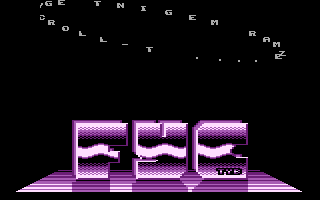
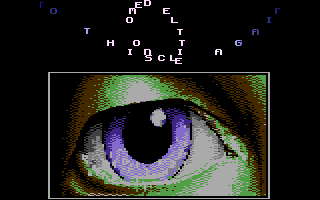
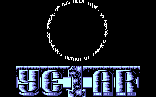

# DXYCP

- Source: https://plus4world.powweb.com/plus4encyclopedia/500196
- Category: Glossary/Demos
- Keywords: dxycp,sprite scroller

DXYCP (or sometimes called a sprite-scroller) is a demo effect which displays scrolling letters. DXYCP stands for Different X and Y Character Position, so all the letters move independently from each other (but the letters themselves do not bend or wave). It could be called a combination of a [DYCP](500011_dycp.md) and a [DXCP](500197_dxcp.md) with at least one overlapping point.

Examples:

[
Toti](https://plus4world.powweb.com/members/Toti)/[FYC](https://plus4world.powweb.com/groups/FYC) proudly shows his crew's tag on the bottom of screen in [Sparkling](https://plus4world.powweb.com/software/Sparkling), while on top a very clean DXYCP spreads text in circle.

 
[5 Years Pluvi Party Celebration](https://plus4world.powweb.com/software/5_Years_Pluvi_Party_Celebration) has two DXYCP parts, one showing 30 elements and another performong a whole 16x16 shaped circlescroll by using 6x6 characters.
