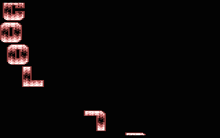

# DXCP

- Source: https://plus4world.powweb.com/plus4encyclopedia/500197
- Category: Glossary/Demos
- Keywords: dxcp

DXCP stands for Different X Character Position, it is a demo effect similar to [DYCP](500011_dycp.md), but the scrolling text is waved horizontally. It's a somewhat rare effect. The difference between a DXCP and a [DXPP](500198_dxpp.md) is that each character has a different x position, not each pixel, that is the whole scroll "waves", but the individual letters are solid.

Examples:

A rare 4x4 DXCP from [Amiga Mania](https://plus4world.powweb.com/software/Amiga_Mania)/[EDC](https://plus4world.powweb.com/groups/EDC).
