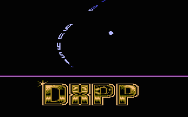

# DXPP

- Source: https://plus4world.powweb.com/plus4encyclopedia/500198
- Category: Glossary/Demos
- Keywords: dxpp See Also DXCP

DXPP is a demo effect, which stands for Different X Pixel Position. It could be called a scrolling [Tech-Tech](500195_tech_tech.md). Basically it's a horizontally waving scroll, where each pixel (line) waves, including the letters. Should not be confused with [DYPP](500014_dypp.md)s, which are very similar. See also [DXCP](500197_dxcp.md).

Examples:

DXPP from [Long Hours](https://plus4world.powweb.com/software/Long_Hours) by [Moldi](https://plus4world.powweb.com/members/Moldi).
