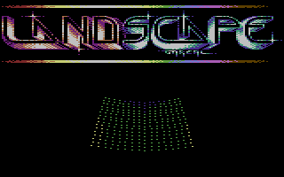
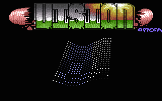
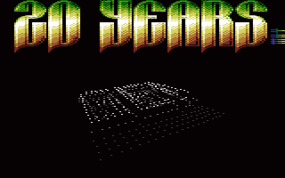

# Landscape

- Source: https://plus4world.powweb.com/plus4encyclopedia/500199
- Category: Glossary/Demos
- Keywords: landscape

Landscape is a demoscene effect which displays a moving image depicting a landscape. On other platforms, this effect has lots of variation, but on the Plus/4 the only kind that we've seen so far is the one that's made up of plots.

It's usually a multi-color effect, where the 3 colors help represent the height variations, and help the effect resemble more like mountains and lakes. However, hires landscapes also exist.

Examples:

The first landscape effect on Plus/4, featured in the 5th part of [Silence](https://plus4world.powweb.com/software/Silence) megademo in 1993, coded by [Steve](https://plus4world.powweb.com/members/Steve)/[SCN](https://plus4world.powweb.com/groups/SCN).

A very fast waving landscape, part of [Infinity](https://plus4world.powweb.com/software/Infinity)/[EVS](https://plus4world.powweb.com/groups/EVS), coded by [Oscar](https://plus4world.powweb.com/members/Oscar) in 1994.

[W-Man](https://plus4world.powweb.com/members/W-Man) of [Gentlemen Software](https://plus4world.powweb.com/groups/GS) had contributed with this part in [Crackers Demo 4](https://plus4world.powweb.com/software/Crackers_Demo_4) cooperation demo. He implemented a very imaginative version of Landscape, a sort of hybrid between different pixel vector classic demo effects: the land turns in circles while the ground has been scanned in X/Y.
