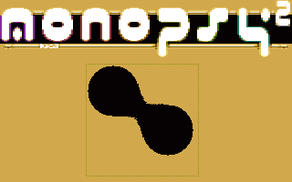

# Metaballs

- Source: https://plus4world.powweb.com/plus4encyclopedia/500200
- Category: Glossary/Demos
- Keywords: metaballs,blobbies,soft objects

The Metaballs are organic-looking n-dimensional objects, which shape is defined by a function (mostly polynomial, in order to speed up the effect) triggered by a thresholding value that defines both their own shape and a sort of "merging radius".

There are several ways to perform this effect on 8bit systems (e.g. both 2D and 3D). Currently there has been only one implementation of this effect, as seen below.

Examples:

One part of [Monopsy 2](https://plus4world.powweb.com/software/Monopsy_2) demo from July 2006, coded by [DCD](https://plus4world.powweb.com/members/DCD)/[WLS](https://plus4world.powweb.com/groups/WLS), shows two fast (and big) 2D hires metaballs. This is the first (and only) metaballs effect on Plus/4.
