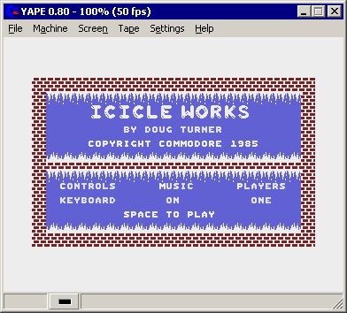
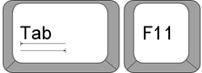
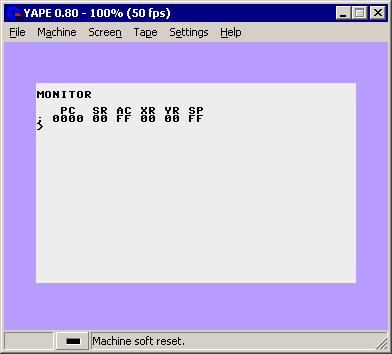
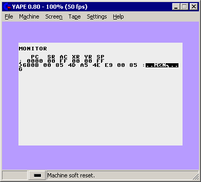

# How Do I Use Cheats?

- Source: https://plus4world.powweb.com/plus4encyclopedia/500209
- Category: FAQ
- Keywords: cheats

If you like old Commodore 16 and Plus/4 games, and want to apply cheats to some of them, then **this page is for you**. Here you will find a **step-by-step guide** to the frequently asked question: "How do I use cheats?"

This example is for [Icicle Works](https://plus4world.powweb.com/software/Icicle_Works), the classic 1985 boulderdash-like action game. The cheats section on the page displays the following:

Run/Stop + Reset: Stop Game
>6B0B 00: Unlimited Time
>64D5 00: Unlimited Men
G 6000: Restart Game

(Do you see different text with the word POKE instead? There's a [note about this below](#poke).)
(Is the cheat marked with "Enter in emulator monitor"? See [this section](#emulatormonitor) then.)
So, what does this mean? Let's see:

Step 1: Run the game in an emulator

This screenshot is taken in [YAPE](https://plus4world.powweb.com/tools/YAPE) (a popular emulator) on Windows. However, most other emulators should look very similar. Our first step is to **stop the game**.

Step 2: Stop the game

You do this by pressing **TAB + F11** at the same time.

Notes:
- On the real computer, this would be holding down the Run/Stop key and pressing the Reset button on the side of the machine.
- In Plus4Emu, this is also TAB + F11.
- In VICE, this is Caps Lock + ALT + R.

Result:

The text MONITOR should appear on the screen. On to the next step!

Step 3: Typing a cheat
Let's apply the cheat that provides unlimited time in all levels. The site says ">6B0B 00: Unlimited Time". This simply means you have to type that in, as shown below:

Once you typed that line, press Enter. This will display some extra characters after what you've typed. Never mind that, that is normal. We're almost done!

**Note about POKE statements:**
Did you just get a question mark when you entered the cheat? Does your cheat begin with the word POKE? If so, your cheat must be entered in BASIC. To get to BASIC from the Monitor, all you have to do is type "X" and press Enter. You will see the text "READY.", and you can now type your POKE cheat.

Step 4: Restarting the game
Now that the cheat has been applied, it's time to start playing again! The site says "G 6000: Restart Game", so let's type that in:

Note that the space between "G" and "6000" is not required (it's fine if you enter it). Once you've type that it, just press enter and voila! The game is running. Start playing, the time will no longer decrease! Enjoy!

**Note about "emulator only" cheats:**
Some cheats we list cannot be applied on a real Commodore computer. The reason for this is that the game cannot be stopped and restarted (the technical reason for this is that a part of the game's code, which is necessary for initialization, gets wiped out). These cheats are marked with **"Enter in emulator monitor"**.

These are the easiest to enter! Assuming you are using YAPE, press ALT+M (or alternatively click Machine/Monitor from the menu). A window with the title "YAPE Monitor" will appear. Now simply type the cheat as-is; or even copy/paste it if you prefer. Close the monitor window. All done!
