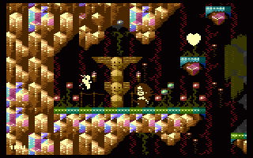

# AGSP

- Source: https://plus4world.powweb.com/plus4encyclopedia/500217
- Category: Glossary/Demos
- Keywords: agsp,any given screen positioning,vsp+lc

AGSP stands for Any Given Screen Positioning, though it's frequently called in an explicit way: VSP+LC.
Actually, AGSP is the straight combination between VSP and [Linecrunch](https://plus4world.powweb.com/kb.php?id=500216), allowing to scroll a bitmap in any direction. Anyway, these are mostly VIC-II tricks, and in general the acronyms are mentioned just as reference. On the 264 series machines you can write the TED registers that track current bitmap position to perform bitmap scrolling in any direction. However this is a register that is reset by TED at the beginning of every frame so you have to update it with the desired value after every reset.

Examples:

After many non-scrolling levels, [Majesty Of Sprites](https://plus4world.powweb.com/software/Majesty_Of_Sprites) unleashes its power sending Kate into AGSP world.
