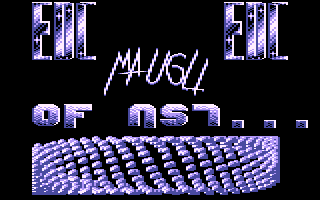
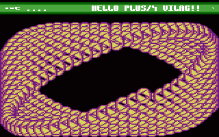

# Infinite Bobs

- Source: https://plus4world.powweb.com/plus4encyclopedia/500218
- Category: Glossary/Demos
- Keywords: infinite bobs, unlimited bobs

Infinite Bobs (aka Unlimited Bobs) is basically an animation, and one of the most classic implementations for [Bobs](https://plus4world.powweb.com/kb.php?id=500192) in general.
At any frame, one single bob has to be added into one of a certain number of buffer bitmaps, which are cyclically displayed to perform an actual animation, looking like all the bobs are moving.

Examples:

[Maugli](https://plus4world.powweb.com/members/Maugli) put a big amount of bobs into one tube-shaped part of [Crackers' Demo 3](https://plus4world.powweb.com/software/Crackers_Demo_3).

[Skoro](https://plus4world.powweb.com/members/Skoro) hits again with the effect in [Crackers' Demo 4](https://plus4world.powweb.com/software/Crackers_Demo_4).
