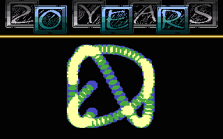
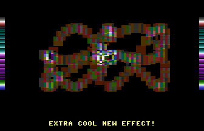
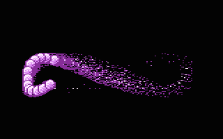

# Shadebobs

- Source: https://plus4world.powweb.com/plus4encyclopedia/500219
- Category: Glossary/Demos
- Keywords: shadebobs

In a generic view, any bobs effect which drops traces to be considered in a secondary interation (like blending) with the [Bobs](https://plus4world.powweb.com/kb.php?id=500192) themselves, can be considered as Shadebobs.

Examples:

An example of shadebobs implementation from the demo [20 Years +4](https://plus4world.powweb.com/software/20_Years_Plus4), by [Skoro](https://plus4world.powweb.com/members/Skoro).

Multiple interactions between the boxes give multiple colors too, weird stuff from [MC](https://plus4world.powweb.com/members/MC)'s [Legend Of MC](https://plus4world.powweb.com/software/Legend_of_MC).

Well, this should be called "firebobs" instead, and it looks really hot'n'burning, courtesy of [Maugli](https://plus4world.powweb.com/members/Maugli), from [Amiga Mania](https://plus4world.powweb.com/software/Amiga_Mania) trackmo.
