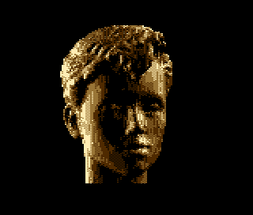
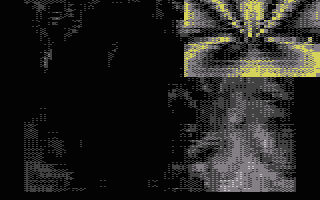

# Bump Mapping

- Source: https://plus4world.powweb.com/plus4encyclopedia/500220
- Category: Glossary/Demos
- Keywords: bump mapping,bumpmapping

Bump Mapping is a computer graphics technique where at each pixel, a perturbation to the surface normal of the object is looked up in a heightmap and applied before the illumination calculation is done.

Examples:

The fantastic 2 lightsources bump mapping part from [Heartfixer 95%](https://plus4world.powweb.com/software/Heartfixer_95) coded by [bubis](https://plus4world.powweb.com/members/bubis).

[Metapharstic 80%](https://plus4world.powweb.com/software/Metapharstic_80) and its anticipation of the modern TVs' PIP option.
