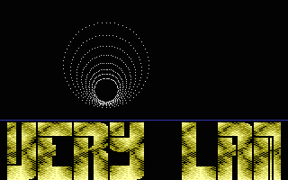
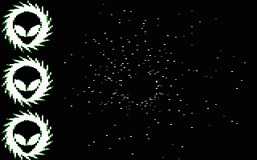

# Dot Tunnel

- Source: https://plus4world.powweb.com/plus4encyclopedia/500221
- Category: Glossary/Demos
- Keywords: dot,tunnel,dottunnel,dot-tunnel See Also Texture-mapped Tunnel, Voxel Tunnel

A "dot tunnel" simulates a first person's view of a tunnel ride, by plotting circles of dots of different sizes.

Examples:

An early little specimen of dot-tunneling, from [Virtually Yours](https://plus4world.powweb.com/software/Virtually_Yours).

The 3 colors dot tunnel in [Chaos](https://plus4world.powweb.com/software/Chaos) trackmo by [DCD](https://plus4world.powweb.com/members/DCD)/[WLS](https://plus4world.powweb.com/groups/WLS), in multicolor mode.
