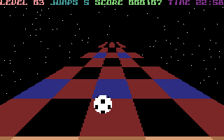
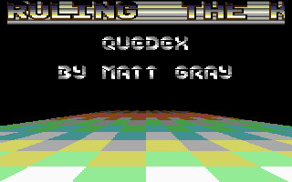

# Trailblazer (Effect)

- Source: https://plus4world.powweb.com/plus4encyclopedia/500222
- Category: Glossary/Demos
- Keywords: trailblazer

A first person's chequered floor moving inward/outward the screen, obtained by combining both rasterlines and graphics, is called "Trailblazer".

Its name comes from the game [Trailblazer](https://plus4world.powweb.com/software/Trailblazer), initially produced just for Commodore 16 and Plus/4 by [Mr. Chip Software](https://plus4world.powweb.com/groups/Mr_Chip_Software) then released even on several other machines by [Gremlin Graphics](https://plus4world.powweb.com/groups/Gremlin_Graphics). That's because several demos showing Trailblazer allow a joystick driving option of the floor.

Examples:

This is a screenshot from the original [Trailblazer](https://plus4world.powweb.com/software/Trailblazer) game.

A direct C64 conversion of the most famous "Trail Mix", thanks to [Ceekay](https://plus4world.powweb.com/members/Ceekay) in the megademo called [Farewell +4](https://plus4world.powweb.com/software/Farewell_Plus4), a complex floor that you can move in any direction via joystick.
