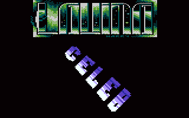
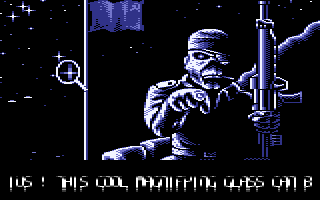

# Lens Deform

- Source: https://plus4world.powweb.com/plus4encyclopedia/500224
- Category: Glossary/Demos
- Keywords: lens,deform

Simulates the spherical aberration effect of a generic lens.

Examples:

lens on [Harry](https://plus4world.powweb.com/members/Harry)'s logo, code by [Lavina](https://plus4world.powweb.com/members/Lavina), from the [GOTU](https://plus4world.powweb.com/groups/GOTU) part in [CD4](https://plus4world.powweb.com/software/Crackers_Demo_4) cooperation demo.

A lens zooming application in [Epic](https://plus4world.powweb.com/software/Epic) megademo by [DCD](https://plus4world.powweb.com/members/DCD), where you can move a magnifying glass over a bitmap.
