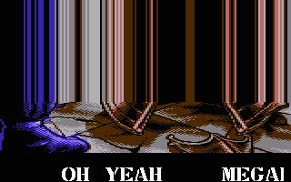

# Liquid Fill

- Source: https://plus4world.powweb.com/plus4encyclopedia/500225
- Category: Glossary/Demos
- Keywords: liquid, fill

Mostly used in building up bitmaps in a fashion, it looks like it's from the same kind of [FPS](https://plus4world.powweb.com/kb.php?id=500227), but even some examples exist of memory juggling instead of scanline managing.

Examples:

Some converted "Last Ninja 2" bitmaps filling in and out in [Oh Yeah](https://plus4world.powweb.com/software/Oh_Yeah)/[DS](https://plus4world.powweb.com/groups/DS) megademo.
