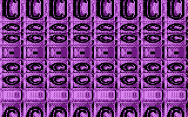
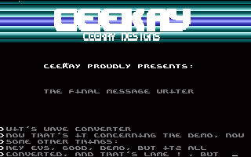
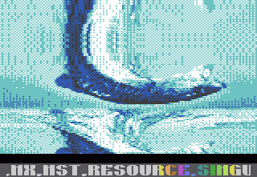
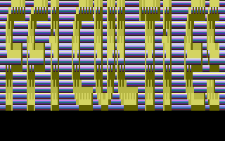

# FPS

- Source: https://plus4world.powweb.com/plus4encyclopedia/500227
- Category: Glossary/Demos
- Keywords: fps,flexible pixel size,stretcher See Also [FPD](https://plus4world.powweb.com/kb.php?id=500213), [FPP](https://plus4world.powweb.com/kb.php?id=500214)

FPS stands for Flexible Pixel Size, and it's also known as Stretcher (not to be confused with simple [Stretcher](https://plus4world.powweb.com/kb.php?id=500239), which is based on graphics manipulation).
Basically it's very similar to [FPD](https://plus4world.powweb.com/kb.php?id=500213), but it fills the empty lines by eventually repeating the last line nth times. Of course [FPP](https://plus4world.powweb.com/kb.php?id=500214) can simulate [FPS](https://plus4world.powweb.com/kb.php?id=500227), but [FPS](https://plus4world.powweb.com/kb.php?id=500227) can operate in different graphic modes, which are precluded in [FPP](https://plus4world.powweb.com/kb.php?id=500214).

Examples:

The 16K demo [Ikaruga](https://plus4world.powweb.com/software/Ikaruga) ends with a screen full of [Cosine](https://plus4world.powweb.com/groups/Cosine) logos that stretches like it was submerged into a glass of water.

You have to load the credits notes as a file apart of [Dominion](https://plus4world.powweb.com/software/Dominion) megademo, in order to see this wonderful lavalamp hires [Ceekay](https://plus4world.powweb.com/members/Ceekay) logo over rasterbars.

Bitmap stretcher, a must see on 16K only, real hardcore coding by [Murphy](https://plus4world.powweb.com/members/Murphy).

If you have to stretch a scrolltext, stretch it up to its maximum. Like [Steve](https://plus4world.powweb.com/members/Steve) did in the obscure megademo [Metapharstic 96](https://plus4world.powweb.com/software/Metapharstic_96).
