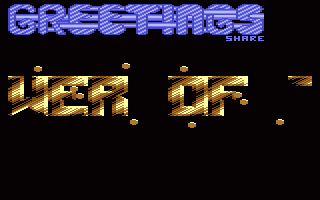
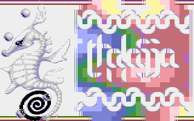
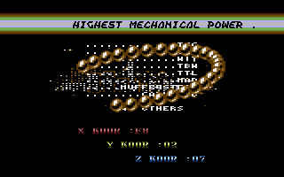

# Sprites

- Source: https://plus4world.powweb.com/plus4encyclopedia/500228
- Category: Glossary/Demos
- Keywords: sprites,sprites,softsprites See Also [Bobs](https://plus4world.powweb.com/kb.php?id=500192)

The 264 Commodore machines have no hardware sprites, due to the effort of packing all the graphics managing in the same single IC with several other stuff to manage. Hence, all the sprites you see running on your program, have to be considered as software driven sprites (softsprites), involving additional dedication in terms of machine time and memory.
Typical in the 264 scene is to make a distinction between [Bobs](https://plus4world.powweb.com/kb.php?id=500192) and sprites: bobs have no other background/foreground element to cope with, whereas sprites have to manage both with themselves and with the background (video matrix or bitmap). Their complexity, and subsequently how much they weigh over the machine, can vary, from simple monochrome sprites, to fully masked and animated sprites.

Examples:

10 little sprites don't fear running over a big scrolltext in the 11th part of [Magic Inspiration](https://plus4world.powweb.com/software/Magic_Inspiration) megademo.

5 fully masked and animated bubble sprites float over a video matrix element in [Thalassa](https://plus4world.powweb.com/software/Thalassa).

A very smart implementations of the [Infinite bobs](https://plus4world.powweb.com/kb.php?id=500218) effect as sprites, up to 256. It's [MC Demo](https://plus4world.powweb.com/software/MC_Demo).
