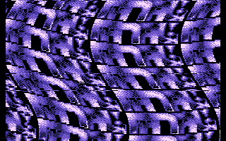
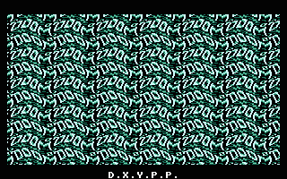
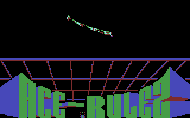

# DXYPP

- Source: https://plus4world.powweb.com/plus4encyclopedia/500229
- Category: Glossary/Demos
- Keywords: dxypp See Also [DYPP](https://plus4world.powweb.com/kb.php?id=500014), [DXPP](https://plus4world.powweb.com/kb.php?id=500198)

The term DXYPP stands for Different X Y Pixel Position. Very CPU intensive, its coding vary depending from the shape of the graphic item used into it, and the range of bending (in particular the X-bending).

Examples:

[MC](https://plus4world.powweb.com/members/MC) really knows how to code a big waving DXYPP, and demonstrates that in [Fatal Mirror](https://plus4world.powweb.com/software/Fatal_Mirror) trackmo.

No fear about memory, even in a 16K category demo like [LOD is back](https://plus4world.powweb.com/software/LOD_is_Back), can stop [Csabo](https://plus4world.powweb.com/members/Csabo) to code down a great DXYPP.

Bend that scrolltext hard! [Xmas Demo 93](https://plus4world.powweb.com/software/Xmas_Demo_93) by [ACE](https://plus4world.powweb.com/software/ACE), part 4.
