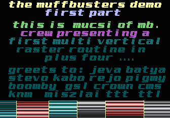
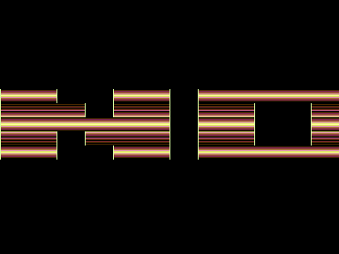
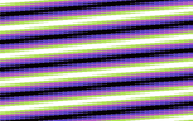
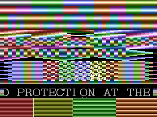

# Raster Split

- Source: https://plus4world.powweb.com/plus4encyclopedia/500230
- Category: Glossary/Demos
- Keywords: raster, split, bug, scroll, white, pixel, badline See Also [FLD](https://plus4world.powweb.com/kb.php?id=500028), [White Pixel Bug](https://plus4world.powweb.com/kb.php?id=500231)

Changing one single colour while the raster is drawing into the screen occurs in a split of the scanline, which looks like horizontally divide a scanline in two (or more) colors, from side to side of the screen.
It has not to be confused with a similar result obtained by changing different colors into specific chars, or similar tricks.

The Raster Scroll is a form of split raster where the position of the first raster is offset each frame. This way, the entire split raster moves like a big horizontal scrolltext.

On TED based machines, this effect can be easily distinguished from the fake one, because of the White Pixel's Bug.
Far from technicalities, it's possible to imagine that the TED swaps between two color in the same scanline in a slowly way, producing a white pixel into the transition zone of both colors, which results in a "snow" view where several of those are performed. This bug can't be circumvented, albeit it's still possible to cover it by characters'masking.

This quickly written code displays a simple split and its original bug, also performing a [FLD](https://plus4world.powweb.com/kb.php?id=500028) in order to keep it clean from potential badlines:

```
	SEI
	STA $FF3F
up	LDA #$B2		; set red background color
	STA $FF15		; ---
 	LDA #$42		; wait for a
loop	CMP $FF1D		; fixed scanline
	BNE loop		; ---
	NOP
bigloop	LDA $FF1D		; do FLD
	ADC #$04		;                                       
	AND #$07		;
	ORA #$18		;
	STA $FF06		; ---
	LDA #$46		; set blue scanline
	STA $FF15		; ---
	LDX #$80		; set FLD ending
	NOP
	NOP
	NOP
	NOP
	NOP
	NOP
	LDA $0000
	LDA #$55		; set green scanline
	STA $FF15		; ---
	NOP
	NOP
	NOP
	NOP
	NOP
	NOP
	NOP
	CPX $FF1D
	BNE bigloop
	LDA #$1B
	STA $FF06
	JMP up
```

Examples:


Raster splits pre-90ies from [Muffbusters](https://plus4world.powweb.com/groups/MB) in [MB Demo](https://plus4world.powweb.com/software/MB_Demo)'s 2nd part.


[Digital Dream](https://plus4world.powweb.com/software/Digital_Dream) has a FLD bouncing raster scroll almost anywhere.


Snow, snow, snow like xmas! [Slowflow](https://plus4world.powweb.com/software/Slowflow) is a good specimen about multiple white pixel bug.


[To Be Ashamed](https://plus4world.powweb.com/software/To_Be_Ashamed) shows some great examples about real and fake raster splits. [Pit](https://plus4world.powweb.com/members/Pit)/[A-System](https://plus4world.powweb.com/groups/A-System) put some real ones in the bottom, whereas all the others are differently coloured characters with $FF14 changed every scanline.
