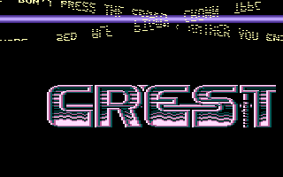
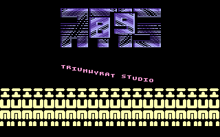
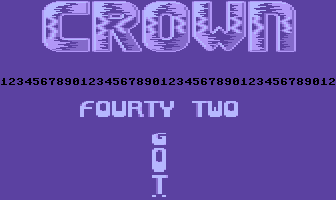

# Rolling Letters

- Source: https://plus4world.powweb.com/plus4encyclopedia/500238
- Category: Glossary/Demos
- Keywords: rolling, letters See Also Stretcher, DYCP, FPP

It looks like an [FPP](https://plus4world.powweb.com/kb.php?id=500214) effect, but it's actually a much elaborated way to use the [DYCP](https://plus4world.powweb.com/software/Dycp) effect, commonly in order to "rotate" textscrollers and charset based logos around a hypothetical horizontal axis.

Examples:

One after one, in the same demo

Double rotating textscrollers in [Conversations II](https://plus4world.powweb.com/software/Conversations_II) part 4.

X-axis rotating logo with overlapped 2-chars DYCP [Conversations II](https://plus4world.powweb.com/software/Conversations_II) part 5.

One of the [Five Magics](https://plus4world.powweb.com/software/Five_Magics): let the letters do roll in a columns.
