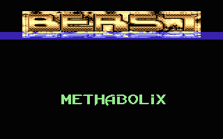

# Stretcher

- Source: https://plus4world.powweb.com/plus4encyclopedia/500239
- Category: Glossary/Demos
- Keywords: rolling, letters See Also DYCP, Rolling Letters

It's a different implementation of general graphics handling, just like [Rolling Letters](https://plus4world.powweb.com/kb.php?id=500238), typical of characters based graphics like e.g. logos, and direct evolution of [DYCP](https://plus4world.powweb.com/software/Dycp)'s. Not to be confused with [FPP](https://plus4world.powweb.com/kb.php?id=500214), which is sometimes named as "stretcher" too.

Examples:

[Digital Brainstorm](https://plus4world.powweb.com/software/Digital_Brainstorm): stretchers are better with water reflections.
