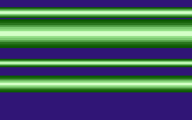

# 3D Rasterbars

- Source: https://plus4world.powweb.com/plus4encyclopedia/500240
- Category: Glossary/Demos
- Keywords: raster,rasters,bars,scaling,coppers,copperbar,3d,3-d

Brief name of the so called "3-D Raster Scaling" effect, as first seen on C64 in [Coma Light XI](http://csdb.dk/release/?id=782) (Oxyron, 1993). Evolution of the classic copperbars, the z-axis perspective effect is generated by changing both the color table and the masking used to 'cut' the rasterbars'sides.

Examples:

A perfect example: [Oldschool 2](https://plus4world.powweb.com/software/Oldschool_2)!

A simpler version of 3D Rasterbars can be seen in [Silence](https://plus4world.powweb.com/software/Silence) (with no side masking).
