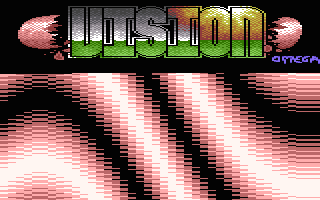
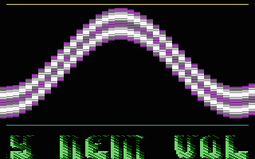
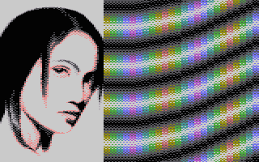

# Copper Plasma

- Source: https://plus4world.powweb.com/plus4encyclopedia/500241
- Category: Glossary/Demos
- Keywords: copper,plasma,fake,splits,charsplits,rastersplits See Also dycp,plasma

Also known as several other names (Fake Splits, Charsplit, Rastersplits). Although the name for this effect recalls both copperbars (rasterbars) and plasma, there's absolutely noone of the two actually involved in it. Basically, it's DYCP with graphics, and it only by visuals reminds some demos on Amiga which actually perform plasmas thru deforming coppers.

Examples:

Copper Plasma is one of the best effects to show while trackloading the next section, just as seen on [Infinity](https://plus4world.powweb.com/software/Infinity).

Let's play snake and fakir: [Coby TCL Mega](https://plus4world.powweb.com/software/Coby_TCL_Mega) showing a conversion from a famous C64 demo.

More colours, from [Ikaruga](https://plus4world.powweb.com/software/Ikaruga).
