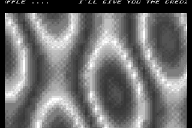
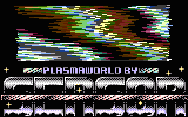
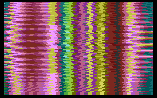
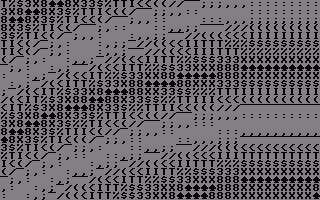
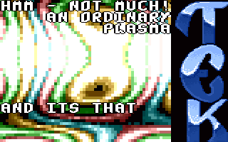

# Plasma

- Source: https://plus4world.powweb.com/plus4encyclopedia/500245
- Category: Glossary/Demos
- Keywords: plasma See Also Copper Plasma,Fire

Plasma is a very widely used effect which uses cycles of colors or items transitions in various ways, in order to show some wobbly animated animations looking like a liquid, organic movement, apparently unpredictable.
Although a plasma can be achieved in several ways, and by using quite different degrees of freedom and complexity, the most common and diffused idea of plasma effect is somewhat linked to assigning gradual color palettes and/or progressively growing graphic elements'tables to the respective values which come from a two-variables noise function, mostly SIN/COS adds/subs.

Examples:

Claimed to be the first plasma effect ported on Plus/4 in 1990 by [Mucsi](https://plus4world.powweb.com/members/Mucsi)/[MB](https://plus4world.powweb.com/groups/MB), it interlaces by flickering two similar screens and lets you choose between 6 patterns (although the setups were malfunctioning, causing the effect to ruin, but redraws one screen in the horrible rate of 7.5 frames.

An early implementation shown in [Digital Brainstorm](https://plus4world.powweb.com/software/Digital_Brainstorm), by colouring byte per byte.

Unleash the power of Quadra Color Density (QCD) in [Future World](https://plus4world.powweb.com/software/Future_World).

Do it with the PETSCII letters only, like [Csabo](https://plus4world.powweb.com/members/Csabo)/[LOD](https://plus4world.powweb.com/groups/LOD) did.

Real candy colors in Zoom4, coded by [Degauss](https://plus4world.powweb.com/members/Degauss)/[TEK](https://plus4world.powweb.com/groups/TEK).
