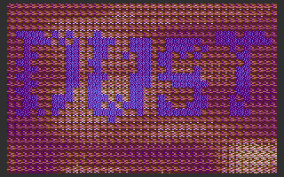
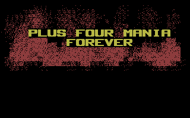
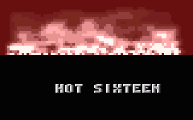

# Fire

- Source: https://plus4world.powweb.com/plus4encyclopedia/500246
- Category: Glossary/Demos
- Keywords: fire,smoke,dust See Also Plasma

Fire effect is very close to the coding for a plasma, with a randomizing addon. A starting row generated by random sinus tables gets slightly changed in all the further rows, which will be affected in their values by the average of the lower ones, until zero is reached at a certain height.
First appeared on C64 in [Coma Light 12](http://csdb.dk/release/?id=11654) and on Plus/4 in [Dust](https://plus4world.powweb.com/software/Dust).

Examples:

The first fire ever on Plus/4 was...[Dust](https://plus4world.powweb.com/software/Dust), to be precise!

Let the title burns in flames of clustered shadeplots: [+4 Mania Forever](https://plus4world.powweb.com/software/Plus4_Mania_Forever)!

[MX](https://plus4world.powweb.com/groups/MX) logo gets burned out in Zoom4 fashion at the beginning of [Hot Sixteen](https://plus4world.powweb.com/software/Hot_Sixteen).
