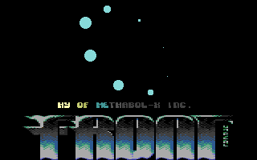
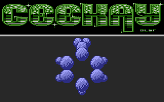
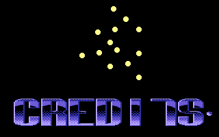

# Vectorballs

- Source: https://plus4world.powweb.com/plus4encyclopedia/500257
- Category: Glossary/Demos
- Keywords: vectorballs,3d bobs,vectorbobs

Bobs are usually running along the screens following a sinus table or similar, and to achieve a better eye pleasing effect they may change their size like [Skoro](https://plus4world.powweb.com/members/Skoro) did, for example, in [Monitor](https://plus4world.powweb.com/software/Monitor), yet remaining simply bobs. Gifting to your moving bobs a third axis in depth makes them look like into a 3D environment, a sensation which can be further enhanced by changing their size coherently with their given position.

The Vectorballs effect can be applied to something very similar to [Bobs](https://plus4world.powweb.com/kb.php?id=500192), in which the single bob's size changes with the depth assigned to that position. They could even not change their size, although they move on the screen to define a 3D object. They can be used like actual 3D elements to build up 3D figures in a tridimensional environment.

Examples:

The front page of [Front Page #001](https://plus4world.powweb.com/software/Front_Page_001): 8 bobs in a 3D environment.

"Make your chemistry lessons great again!" with [Molecule Editor V1.10](https://plus4world.powweb.com/software/Molecule_Editor_V1_10) featuring full 3D vectorballs.

Are they bobs? Are they vectors? They're Vectorbobs from [Skoro Demo 10](https://plus4world.powweb.com/software/Skoro_Demo_10).
