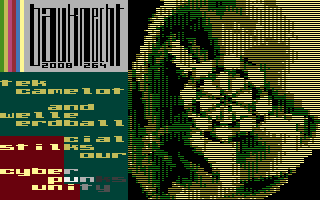

# Twirl

- Source: https://plus4world.powweb.com/plus4encyclopedia/500259
- Category: Glossary/Demos
- Keywords: twirl,ripple,radial

Twirl is a 2D center-based radial distorsion effect on a bitmap picture.

Examples:

Area 51 is twirling around in [Threeve](https://plus4world.powweb.com/software/Threeve)!
