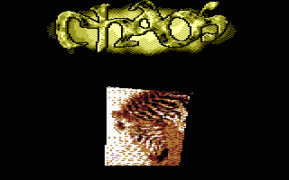

# Texture Mapping

- Source: https://plus4world.powweb.com/plus4encyclopedia/500260
- Category: Glossary/Demos
- Keywords: mapping

Texture mapping applies a two-dimensional surface, called "texture map", wrapped around a proper three-dimensional object.

Examples:

I say zebra! You say zebra! We say [Chaos](https://plus4world.powweb.com/software/Chaos) by [DCD](https://plus4world.powweb.com/members/DCD)!
