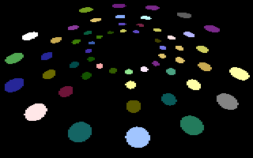
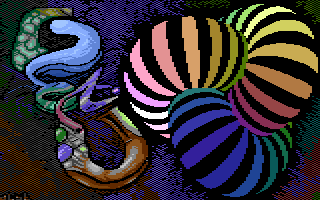

# Color Cycler

- Source: https://plus4world.powweb.com/plus4encyclopedia/500261
- Category: Glossary/Demos
- Keywords: color cycling,cycler,colorcycling

Several frames of predrawn/precalculated animation is used in a cyclic way (multicolor bitmap or character mode) while at the same time the color memory is also rewritten accordingly to create an illusion of differently colored individual objects moving smoothly, which otherwise would not be possible in real time due to hardware limitations.

Examples:

[Promised Land](https://plus4world.powweb.com/software/Promised_Land) promises to you a land of funny disco lights.

[Lavina](https://plus4world.powweb.com/members/Lavina)/[GOTU](https://plus4world.powweb.com/groups/GOTU)'s colorcyclers featured in [Promised Land](https://plus4world.powweb.com/software/Promised_Land) are a Plus/4 first's.
