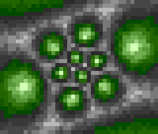
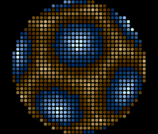
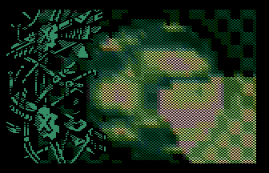

# Sphere Mapping

- Source: https://plus4world.powweb.com/plus4encyclopedia/500262
- Category: Glossary/Demos
- Keywords: spherical mapping,mapping,sphere rotator See Also Texture-mapped Tunnel

Often confused with sphere [Texture Mapping](https://plus4world.powweb.com/kb.php?id=500260), which wraps a graphic element around a spherical shape.

Sphere Mapping describes a spherical environment by defining the space via various types of textured surfaces. This results in a rotating round object seen from the outside, as well as the inside of a spherical setting.

Examples:

Life inside a sphere in [Heartfixer 95%](https://plus4world.powweb.com/software/Heartfixer_95).

Life outside a sphere in [Heartfixer 95%](https://plus4world.powweb.com/software/Heartfixer_95).

[Rocket Science](https://plus4world.powweb.com/software/Rocket_Science): oh my, that's gonna explode!
