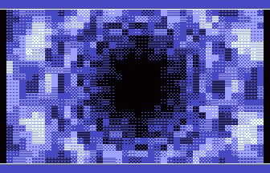
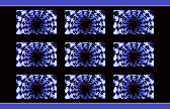
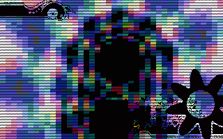

# Texture-mapped Tunnel

- Source: https://plus4world.powweb.com/plus4encyclopedia/500263
- Category: Glossary/Demos
- Keywords: texture tunnel,floormapper See Also Sphere Mapping,Dot Tunnel,Voxel Tunnel

Why pushing on your own imagination so hard, defining a [Dot Tunnel](https://plus4world.powweb.com/kb.php?id=500221), when you can have a texture based radial effect which lools like traveling into a solid defined tunnel? Beware: texture's nature may vary in source code.

Although running with a different principle, Floormappers can be considered as a form of plain texture-mapped tunnel too

Examples:

 
[We Are The Cure](https://plus4world.powweb.com/software/We_Are_The_Cure): one texture tunnel, many texture tunnels. Multiplicity counts! And you can even dive into it with a joystick.

We have fresh [Notizen Aus Der Provinz](https://plus4world.powweb.com/software/Notizen_Aus_Der_Provinz) for you: two tunnels are better than one.
