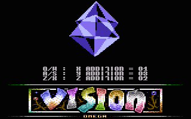
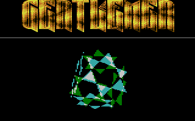
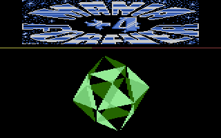

# Glenz Vectors

- Source: https://plus4world.powweb.com/plus4encyclopedia/500264
- Category: Glossary/Demos
- Keywords: vector,vectors,filled,solid,glenz,transparent,triangles

Glenz Vectors are 3D objects which are basically made of triangles, at least in their original 16bit ancestors. The overall resulting aspect is a translucent or transparent solid, like partially see-through model with a "diamond-like" look. First seen in [Megademo 8](https://demozoo.org/productions/9857/) by Kefrens released in date 1990-02-18, the effect acquired its name thanks to [Photon](https://www.scoopex1988.org/photon.html) from the Swedish word *Gläns* (transl.: glisten).

Examples:

The 7th part of [Virtually Yours](https://plus4world.powweb.com/software/Virtually_Yours) megademo by [EVS](https://plus4world.powweb.com/groups/EVS) allows you to play with a glenz vectors glass hourglass.

Now this is a very complex Glentz solid from [Genetic Faulty](https://plus4world.powweb.com/software/Genetic_Faulty) , looks like snowflakes into a rotating box!

A big Glentz Vector among a plethora of different solid vectors takes place in [+4 Mania Forever](https://plus4world.powweb.com/software/Plus4_Mania_Forever).
