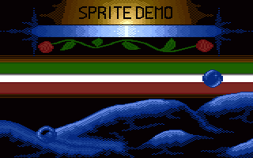
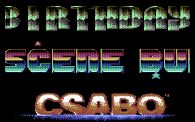
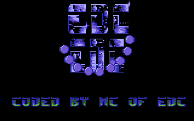

# Sprite

- Source: https://plus4world.powweb.com/plus4encyclopedia/500266
- Category: Glossary/Demos, Programming/Assembly, History
- Keywords: sprite,softsprite,software See Also Bobs

**Historical Background**
The Commodore 264's TED chip, which takes care of the graphics, does not support hardware sprites, whereas the Commodore 64's VIC-II does. The C64 was intended to be a home computer which could compete with the coin-op games of the same era, featuring the possibility to write programs on it too; the Plus/4 was first intended to be a cheaper choice against low end first entry machines both in America and in Europe (e.g.: the Sinclair's ZX Spectrum); later, the addition of the custom ROM adding some barely useful business utilities has represented a poor attempt to affect the arising PCs' market on the prices side. On both sights, no need and no room left for hardware sprites was intended to be.

This means that the term *sprite* referring to a C16, C116 or Plus/4 production, is always intended as: ***software sprite*** (abbr.: ***softsprite***).

**Technical Details**
A ***sprite*** is a graphic object that is rendered over or under a background, and stands or moves its structure independently from the graphic elements involving the background.
Originally intended as *hardware sprite* only, nowadays the term refers to a more general definition, including both the sprites displayed on completely different hardware video layers, and the software sprites calculated within a single common graphic environment, by "carving" transparent "holes" into the background by alone (*sprite masking*), and then by overlapping the needed graphics net of the chosen transparency color. This procedure can be performed both in bitmap and screen matrix environments, at different levels of code complexity, based on the specific features needed case by case.

**A Practical Example**
The demo [Thalassa](https://plus4world.powweb.com/software/Thalassa) shows some 2x2 chars shaped masked animated softsprites. Here follows a brief step by step explanation of the way they work.

This is the animated sprite that has to be placed over the background composed by characters. Let's choose the location identified by the red square in the proposed screenshot. It's a 2x2 characters sized bubble, includes all the available 4 colors, and its animation table picks up 4 frames overall

For a 4 frames animated sprite, both mask and graphics have been drawn, doubling to 8 the elements that are needed.

The chosen way to set this object into the desired coordinates involves the use of *pre-shifted graphics* in order to make the calculation of the horizontal position much easier: why to afford costly and boring calculations, if we can simply pick the right X-shifted graphics from a lookup table? Having a multicolor environment, means that 4 pre-shifted elements are needed both for masks and graphics. Said that, the eight items previously identified, are now multiplied by 4 and become 32 overall.
The vertical coordinate will be calculated by shifting the original graphics at the moments of both the mask "carving" and the final overlap of the graphics, a relatively simpler task than the previous one because the bytes of a character are visually sequenced vertically.

The most important thing to underline is that, having to shift and pre-shift the graphic elements, there is the need to overall resize a sprite shaped in N*N characters, to a size of (N+1)*(N+1) characters, to make room for the graphics when sliced in the different character boxes. To display and move a 2x2 characters' sprite, all the used graphic elements are 3x3 chars big.

Have a zoomed view of the previously chosen red lined box, this is it. Once localized reading the sprite's movement table, the corrensponding involved characters are copied into the sprite's assigned characters in the same charset, to be later printed in the same place once that the whole softsprite has been calculated. Of course, any eventual group of sprite's characters that have been placed before, must be removed by restoring the original background, before starting to calculate a new one.

First, let's mask the sprite. Once the right frame has been picked up by the animation's lookup table, the code must indent the original background graphics with the mask. In this example, the code considers the white pixels, assigning the black one the role of transparency. This can be done by ORing or ANDing the background, based on the colours which have been chosen for the mask.

Mask on! This is what remains in the group pf characters used to assemble our softsprite, at the end of the masking operation. Moreover, given that the fixed background color corrensponding to the "empty" $00 pixels ($FF15) in this example is the white one, the masking operation also fixes the pixels proper of the sprite which will appear to be colored like that (see the little light reflection on the bubble): drawn now, it won't be overlapped by the consequent graphics in the second step, and will be preserved in the final result.

It's now time to overlap the bubble's graphics. Now the transparent color is actually the white, corresponding to $00 pixels ("holes"), so it can be easily ORred over the involved background, after that it has been previously cleaned away of any other pixel which would have possibly interacted with this operation due to undesired bits crossing.

Softsprite done! See how the wise usage of mask + graphics has saved the white reflection on it. One down, next!

Examples:

The [Multigraph Sprite Demo](https://plus4world.powweb.com/software/Multigraph_Sprite_Demo) has been specifically made by [Frog](https://plus4world.powweb.com/software/Frog), to show those two big 12x16px buddies moving around in a bitmap environment.

Happy birthday! Here's my present for you: [Smells Like Happy Birthday](https://plus4world.powweb.com/software/Smells_Like_Happy_Birthday) shows two 2x2 chars sprites traveling both under and over a big textscroller.

In the past, going beyond the frustration of not having hardware sprites by coding softsprites could make you a legendary coder! This is it: 9 2x2 chars sprites over a logo, from [Legend Of MC](https://plus4world.powweb.com/software/Legend_Of_MC).
