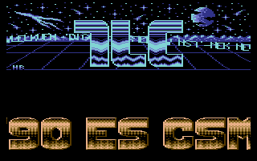
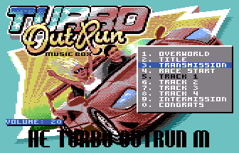
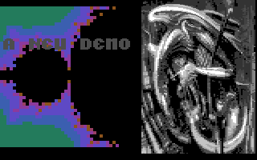
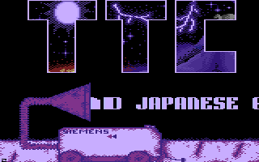

# Sprite Scroll

- Source: https://plus4world.powweb.com/plus4encyclopedia/500267
- Category: Glossary/Demos, Programming/Assembly, Programming/General
- Keywords: sprite,scrolling,scroll,text, See Also Sprite

Sprite Scroll is a textscroller which doesn't use the hardware scrolling registers, instead produces this effect by performing cycles of background restoring and graphics overlapping – mostly in bitmap environment, but possibly in screen memory too – sometimes with the addon of an alteration of the letters themselves. Clearly, the 'sprite' term refers to the specific definition of it for the 264 systems (see [Sprite](500266_sprite.md)), as the moving text may be described as an application of the softsprite's programming.

Examples:

Part 5 of [First Demo (TLC)](https://plus4world.powweb.com/software/First_DemoTLC), it's now time to read a long story from behind my nickname's logo, are you ready for this?

Faster than the F40 portrayed on its own bitmap to be overlapped, here's the 3 chars tall scrolltext in [Turbo Outrun Music Box](https://plus4world.powweb.com/software/Turbo_Outrun_Music_Box).

Over a Mandelbrot Zoomer, a bitmap scroller can shine, as in the last part of [Perfect Visions 2](https://plus4world.powweb.com/software/Perfect_Visions_2).

Oh my, there's a vacuum cleaner device in [Terminal Obsession](https://plus4world.powweb.com/software/Terminal_Obsession) part 3, and it's deforming my letters!
