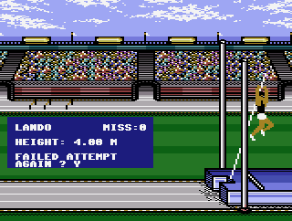
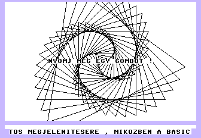
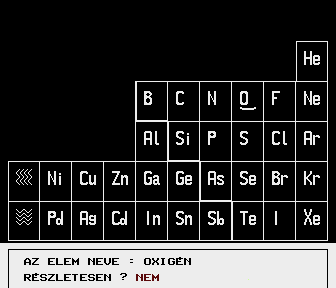
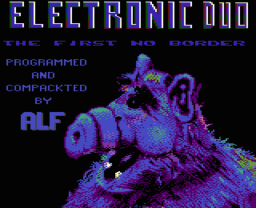
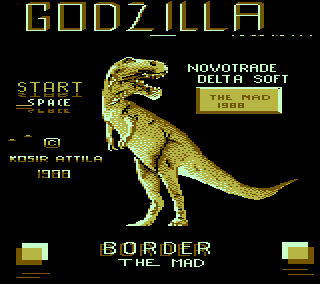
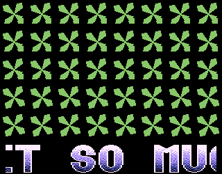
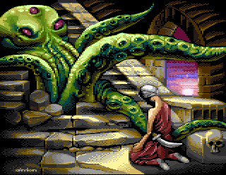
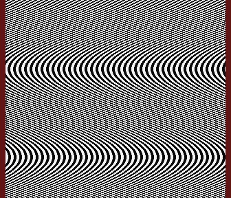

# Extended Vertical Border

- Source: https://plus4world.powweb.com/plus4encyclopedia/500268
- Category: Glossary/Demos, Programming/Assembly, Programming/General
- Keywords: extended,vertical,border See Also Sprite

Why wasting both those two big empty and unused slices of the screen – one placed on top of the visible area, the other starting from the bottom of it – when we could trick the TED and stuff'em with textscrolliers, logos, whatever? Although this effect may appear to work identically on the C64 as it does on the Plus/4, the two approaches come from different characteristics involved: on C64, this effect can be easily achieved exploiting a flaw of the VIC-II, while on the Plus/4 you usually force a subsequent value of the raster in the instant when it should turn off the screen and become border. Since on the Plus/4, the CPU doubles its calculation frequency when the raster writes to the border, the initial "overshoot" will have to be recovered somehow by writing more times in the raster register, before it restarts from a new frame update. In this way, the speed of the onscreen display will be brought back to the normally expected synchronous value.

Examples:

 
 
Ancestors of the effect from the year 1987: the incredible overscan along the whole [Summer Events](https://plus4world.powweb.com/software/Summer_Events); [Extended Screen](https://plus4world.powweb.com/software/Extended_Screen), a pioneering first study; an interesting application in an early educational program called [Kémia](https://plus4world.powweb.com/software/Kemia); someone in 1988 felt the needing to explicitly declare his demo as the first one, see [Alf Demo](https://plus4world.powweb.com/software/Alf_Demo).

Do you see my extended border? Do you see it? See? See? It's the one with the big "BORDER" logo! Saw it?

[Oxygene Demo](https://plus4world.powweb.com/software/Oxygene_Demo): overscan with digisound, in a 256kB environment, cool!

Art is bitmap, hence more art is more bitmap to display! [Kracken Prince](https://plus4world.powweb.com/software/Kracken_Prince)!

[Sinx+Siny](https://plus4world.powweb.com/software/SinxPlusSiny) = 128 bytes, get maximum border opening in minimum sized demo.
