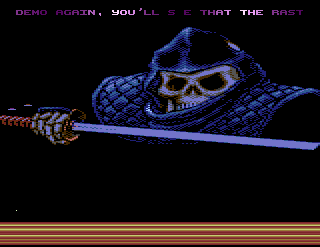
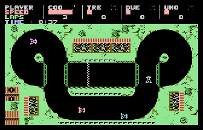

# SID Support

- Source: https://plus4world.powweb.com/plus4encyclopedia/500269
- Category: Glossary/Demos, Programming/Audio, Hardware/Troubleshooting
- Keywords: sid,card,sidcard,sidkarte,sid-card,sid-karte,support,6581,8580,sound See Also DIGIMUZ Support

The SIDcard is a hardware device to be plugged into the Expansion Port, which allows the usage of the SID chip – acronym for "Sound Interface Device", responsible for the sound output on the Commodore 64 – on a Commodore Plus/4. The first [SIDcard](https://plus4world.powweb.com/hardware/Solders_SID_Card) built up by [Solder](https://plus4world.powweb.com/members/Solder)/[Synergy](https://plus4world.powweb.com/groups/SYN) around September 1992, did define a standard for the models which have been produced next to it. It supported the SID8580r5 model mainly, which needs a lower voltage, but the schematics can be easily modified to hold a SID6581. In addition to the audio related advantages, the presence of a 9-pins DB9 joystick port allows the usage of a third joystick, and the connector can also support a proportional mouse, taking advantage of the A/D converter featured by the SID.

SID Support covers both the usual production which take advantage of the SIDcard sound, and any program which uses the hardware's joystick port only.

Examples:

[Ninja 3 Demo](https://plus4world.powweb.com/software/Ninja_3_Demo) is part of the [Synergy SIDcard Software](https://plus4world.powweb.com/software/Synergy_SIDcard_Software) collection which has been released in conjunction with the SIDcard. It's the first demo ever to use SIDcard, and it represents a straight answer to [Nukeman](https://plus4world.powweb.com/members/Nukeman) and his own doubts about that hardware, published in [Nukepaper 05](https://plus4world.powweb.com/software/Nukepaper_05).

There's no SID sound playing in [Karting Grand Prix 101%](https://plus4world.powweb.com/software/Karting_Grand_Prix_101), but this specific hack of the debatable original game assigns the joystick port of the SIDcard to the eventual 3rd player, instead of crowding the keyboard with fingers.
