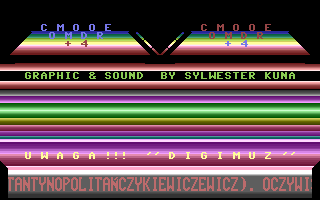
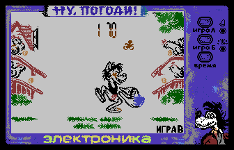
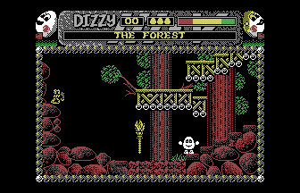

# DIGIMUZ Support

- Source: https://plus4world.powweb.com/plus4encyclopedia/500270
- Category: Glossary/Demos, Programming/Audio, Hardware/Troubleshooting
- Keywords: digimuz,ay,psg,AY-3-8910,psg See Also SID Support

[DIGIMUZ](https://plus4world.powweb.com/hardware/DIGIMUZ) is a hardware device to be plugged into the Expansion Port, which allows the usage of the AY-3-8910 chip on a Commodore Plus/4. Designed and built in Poland by Tadeusz Zawadowski in late 1991, and surfaced to popular knowledge during the early days of 2021 only, the hardware did not have the possibility of greater diffusion, and the only programs that feature music for this card were written by [BKP](https://plus4world.powweb.com/members/BKP), who is the owner of the Card no. 003.

Examples:

[BKP](https://plus4world.powweb.com/members/BKP) wrote three demos in order to test and present the capabilities of the DIGIMUZ, and [Demo 1](https://plus4world.powweb.com/software/Demo_1) was released on 1991-10-24.

If by hypothesis we could have not only infinite lives in a game, but also multiple expansion ports, TED, SID and AY would play together at the same time. [Nu, Pogodi!](https://plus4world.powweb.com/software/Nu_Pogodi) makes us live the dream through emulators.

Why convert the music, or even rewrite it from scratch, if you can directly make the Plus/4 sing like the Spectrum 128K would sing? [Dizzy Three and a Half](https://plus4world.powweb.com/software/Dizzy_Three_and_a_Half) follows that precise path.
